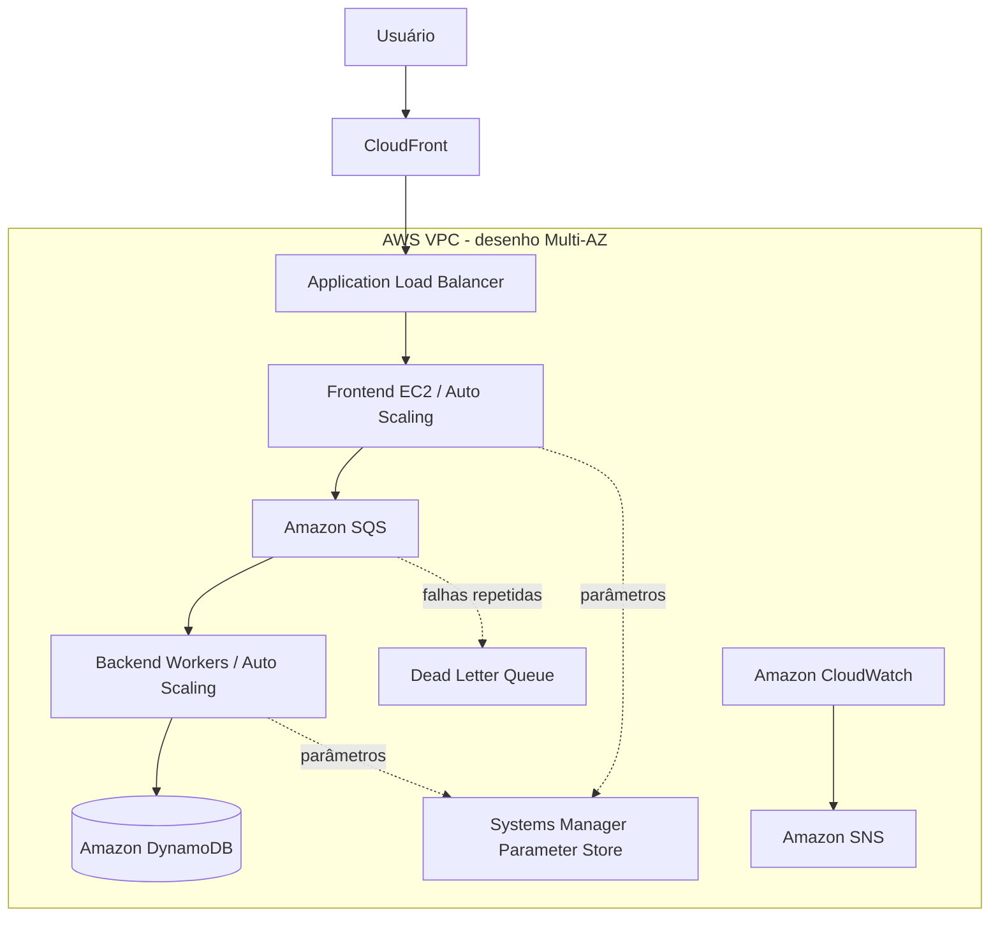

# Semana de Arquitetura AWS
## System Design Portfolio — Arquitetura em três camadas, desacoplamento e resiliência

Este repositório documenta a construção e a evolução de uma aplicação web de três camadas na AWS, desenvolvida no contexto da Semana de Arquitetura da Escola da Nuvem. O objetivo é transformar o laboratório em um estudo de caso de **System Design**, registrando requisitos, decisões arquiteturais, componentes, validações, dificuldades e oportunidades de melhoria.

> **Escopo e transparência:** este é um laboratório educacional, não uma declaração de ambiente produtivo. Diagramas representam a visão arquitetural do desafio. Cada recurso será identificado como planejado, implementado ou validado somente quando houver evidência correspondente.

## Visão executiva

O desafio propõe receber solicitações de usuários, desacoplar a entrada do processamento por mensageria e persistir os resultados. A arquitetura evolui em três etapas: construção da fundação, endurecimento de segurança e elasticidade, e operação com observabilidade e resiliência.

### Jornada do projeto

| Etapa | Título | Foco |
|---|---|---|
| Dia 1 | **Construindo a fundação — três camadas e processamento assíncrono** | VPC, ALB, EC2, SQS e DynamoDB |
| Dia 2 | **Endurecendo a arquitetura — configuração segura e elasticidade** | Parameter Store, Session Manager, Launch Templates, ASG, CloudFront e DLQ |
| Dia 3 | **Operando a arquitetura — observabilidade e resiliência** | CloudWatch, SNS, métricas de backlog, escalabilidade e testes |

## Topologia macro

O desenho abaixo é uma visão lógica consolidada do desafio. A topologia real, os CIDRs, as rotas e o estado de cada componente devem ser confirmados nas páginas dos laboratórios e nas evidências.

### Componentes em resumo

| Camada/capacidade | Serviços | Responsabilidade |
|---|---|---|
| Entrada e distribuição | CloudFront, ALB | Distribuir requisições e encaminhar tráfego |
| Rede | VPC, sub-redes, route tables, IGW e NAT | Segmentar conectividade |
| Apresentação | EC2 e Auto Scaling | Hospedar frontend |
| Mensageria | SQS e DLQ | Desacoplar e isolar mensagens com falha |
| Processamento | EC2 Workers e Auto Scaling | Processar mensagens de forma assíncrona |
| Persistência | DynamoDB | Armazenar registros |
| Segurança e operação | IAM, Parameter Store e Session Manager | Controlar permissões, parâmetros e acesso |
| Observabilidade | CloudWatch e SNS | Métricas, alarmes e notificações |

## Baseline de infraestrutura

O README anterior registrava região `us-east-2`, VPC `10.0.0.0/16`, duas sub-redes públicas e quatro privadas distribuídas em duas AZs. Esses valores são **baseline registrado**, ainda sujeitos à confirmação com evidências originais do ambiente. Os CIDRs individuais, tabelas de rotas e associações devem ser preenchidos após conferência.

## Documentação por etapa

- [Dia 1 — Construindo a fundação](docs/labs/day-01-foundation.md)
- [Dia 2 — Segurança e elasticidade](docs/labs/day-02-security-scaling.md)
- [Dia 3 — Observabilidade e resiliência](docs/labs/day-03-operations.md)

## Documentação transversal

- [Assessment, requisitos e critérios de validação](docs/01-assessment.md)
- [Visão geral da arquitetura, camadas e topologia de rede](docs/02-architecture.md)
- [Mapeamento de assuntos para SAA-C03](docs/03-saa-c03-mapping.md)
- [Well-Architected, CAF, LGPD e FinOps](docs/04-frameworks-and-governance.md)
- [Architecture Decision Records (ADRs)](docs/adr/README.md)
- [Índice da documentação](docs/index.md)
- [Evidências técnicas e troubleshooting](evidence/README.md)

## Evidências e rastreabilidade

O portfólio deve mostrar não apenas o resultado final, mas também como o resultado foi obtido:

1. Requisito ou problema registrado.
2. Decisão técnica documentada (ADR quando aplicável).
3. Implementação identificada.
4. Teste com procedimento e resultado observável.
5. Evidência sanitizada e vinculada à documentação.
6. Limitações e melhorias propostas.

Quando não houver captura de tela, a dificuldade poderá ser registrada como relato retrospectivo, claramente identificada como tal. Não serão recriados prints ou logs apresentados como evidência original.

## Relação com a certificação AWS SAA-C03

O projeto aborda assuntos relacionados aos quatro domínios do exame: arquiteturas seguras, resilientes, de alto desempenho e com custo otimizado. A matriz de estudo e o método de pontuação de profundidade das evidências estão em [Mapeamento SAA-C03](docs/03-saa-c03-mapping.md). A pontuação do portfólio não representa nota prevista no exame.

## Decisões de implementação e IaC

O laboratório foi executado com foco em compreender e configurar os serviços AWS. Terraform, CloudFormation ou Kiro não devem ser declarados como utilizados se não fizeram parte da execução registrada. A documentação explicará quando a infraestrutura foi configurada manualmente e por que a adoção de IaC pode ser uma evolução futura: repetibilidade, versionamento, revisão e reconstrução do ambiente.

## Gestão do trabalho

- **GitHub Projects:** quadro Kanban, prioridades e marcos.
- **GitHub Issues:** tarefas, problemas, critérios de aceite e rastreabilidade.
- **GitHub Discussions:** dúvidas técnicas e conversas que não representam uma tarefa executável (habilitar nas configurações do repositório, se disponível).
- **GitHub Actions:** validação automática de links locais da documentação; validações de IaC podem ser adicionadas quando Terraform/CloudFormation forem incluídos.
- **GitHub Pages:** publicação da documentação como portal navegável, após habilitar Pages com origem GitHub Actions.

## Segurança e custos

Não publicar credenciais, tokens, IDs de conta, dados pessoais, endereços IP públicos desnecessários ou valores sensíveis do Parameter Store. Avaliar custos de EC2, NAT Gateway, ALB, CloudFront, SQS, DynamoDB e CloudWatch antes de manter recursos ligados. Ao concluir cada laboratório, seguir a orientação do instrutor sobre limpeza; não manter recursos ativos apenas para preservar o portfólio.

## Sobre este estudo de caso

Projeto prático de aprendizagem e portfólio individual. O conteúdo deve distinguir claramente o que veio do roteiro da Escola da Nuvem, o que foi efetivamente executado e o que constitui recomendação técnica ou evolução futura.
