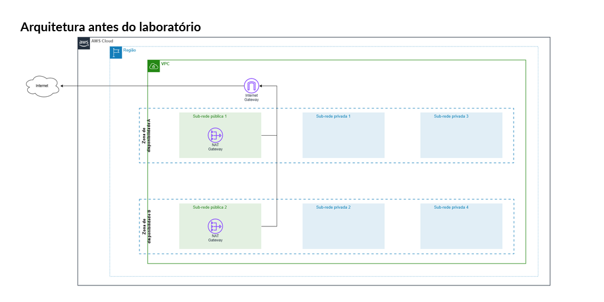
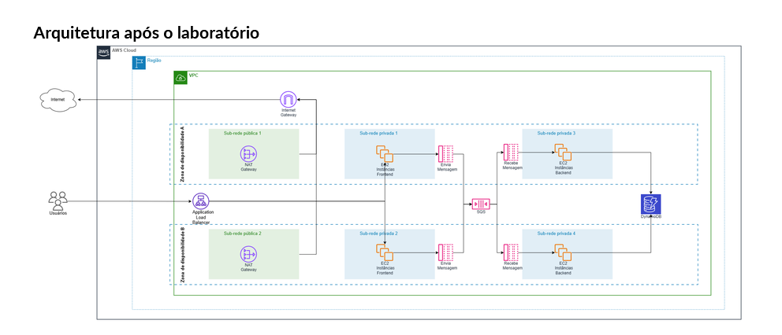

# 🏛️ Semana da Arquitetura AWS: Arquitetura em 3 Camadas Altamente Disponível e Desacoplada

Projeto prático de arquitetura corporativa e System Design em nuvem AWS, implementando uma aplicação em três camadas projetada sob os pilares de resiliência, alta disponibilidade (Multi-AZ), desacoplamento assíncrono via mensageria e segurança em profundidade (*Defense in Depth*).

---

## 📐 Diagramas da Arquitetura

### Arquitetura Inicial (Baseline)


### Arquitetura Final Implementada (3 Camadas Resiliente)


## 📐 Topologia da Arquitetura

O sistema implementa o fluxo clássico de três camadas com buffer assíncrono para proteção contra picos de tráfego:

```text
[ Usuário / Internet ]
         │ (HTTP :80)
         ▼
[ Application Load Balancer ] (Público / Multi-AZ)
         │
    ┌────┴────────────────────────┐
    ▼                             ▼
[ EC2: Frontend 1 ]         [ EC2: Frontend 2 ] (Sub-redes Privadas)
(AZ: us-east-2b)            (AZ: us-east-2a)
    │                             │
    └────┬────────────────────────┘
         │ (JSON com UUID + Payload)
         ▼
[ Amazon SQS: Fila Padrão ] (Buffer Assíncrono)
         │
    ┌────┴────────────────────────┐
    ▼                             ▼
[ EC2: Worker Backend 1 ]   [ EC2: Worker Backend 2 ] (Sub-redes Privadas)
(Consumo Long Polling)       (Consumo Long Polling)
    │                             │
    └────┬────────────────────────┘
         │ (Gravação NoSQL)
         ▼
[ Amazon DynamoDB ] (Tabela Sob Demanda)


## ⚙️ Componentes da Infraestrutura

### 1. Camada de Rede (Amazon VPC)
* **Região:** `us-east-2` (Ohio)
* **Topologia Multi-AZ:** Redundância distribuída nas Zonas de Disponibilidade `us-east-2a` e `us-east-2b`.
* **Sub-redes Públicas:** Hospedagem dos nós do balanceador (ALB), com saída via Internet Gateway (IGW).
* **Sub-redes Privadas:** 
  * Camada Web (Frontend 1 e 2): isoladas de tráfego de entrada da internet.
  * Camada de Processamento (Backend Workers 1 e 2): isoladas sem IP público.
* **Saída de Rede Segura:** NAT Gateway regional para permitir que as instâncias privadas instalem dependências (`pip`, `yum`) sem expor portas à internet.

### 2. Governança e Segurança (Zero Trust & Least Privilege)
* **Encadeamento de Security Groups:** O grupo de segurança dos servidores EC2 aceita tráfego HTTP exclusivamente com origem referenciada no Security Group do Application Load Balancer. Nenhuma máquina aceita tráfego público direto.
* **IAM Instance Profile:** Instâncias utilizam Roles temporárias (`ec2-role-...`) para comunicação com o SQS e DynamoDB, eliminando por completo o armazenamento de credenciais estáticas (*Access Keys*) no código-fonte.

### 3. Camada de Apresentação (Frontend)
* Aplicação desenvolvida em Python 3 com micro-framework Flask.
* Provisionada via script de inicialização (*User Data*) automatizado, gerenciada como serviço pelo `systemd`.
* Cada submissão gera um `requestId` único (UUID v4) e despacha o evento diretamente para a fila SQS.

### 4. Camada de Desacoplamento (Amazon SQS)
* Fila padrão atuando como buffer assíncrono.
* Garante absorção de picos de tráfego (*traffic spikes*), evitando sobrecarga e queda da camada de banco de dados caso ocorra uma enxurrada de requisições simultâneas.

### 5. Camada de Processamento Assíncrono (Backend Workers)
* Workers executando em Python consumindo mensagens via *Long Polling* (espera de 20 segundos) para otimizar custos e reduzir chamadas de API vazias.
* Extração do payload, gravação estruturada no banco de dados e remoção da fila via `ReceiptHandle` apenas após a confirmação da escrita.

### 6. Camada de Persistência (Amazon DynamoDB)
* Tabela NoSQL com modelo de capacidade sob demanda (*On-Demand*).
* Partition Key: `requestId` (String).
* Armazenamento com carimbos de auditoria: `received_at` e `processed_at`.

---

## 🧪 Evidências de Testes de Integração

1. **Alta Disponibilidade e Balanceamento:**
   * Target Group validado com alvos em estado **Healthy** distribuídos entre as zonas `us-east-2a` e `us-east-2b`.
2. **Ingestão Assíncrona:**
   * Requisições submetidas via formulário web com retorno de status de sucesso imediato para o usuário.
3. **Métricas de Fila:**
   * Monitoramento do CloudWatch registrando entrada de mensagens no SQS e esvaziamento imediato pelos workers de backend.
4. **Persistência Confirmada no DynamoDB:**
   * Validação com 100% de eficiência de leitura e escrita dos registros com integridade de dados preservada.

---

## 💡 Princípios do AWS Well-Architected Framework Aplicados

* **Confiabilidade:** Separação Multi-AZ em todas as camadas e recuperação automática de serviços com `systemd`.
* **Segurança:** Isolamento em redes privadas, grupos de segurança interdependentes e controle de acesso baseado em papéis (IAM).
* **Eficiência de Performance:** Desacoplamento entre ingestão e processamento por meio de mensageria assíncrona.

</Step>

  <Step subtitle="1 min" title="Commit e Push no GitHub Desktop">
    Abra o **GitHub Desktop**. No canto inferior esquerdo, escreva no resumo:
    `fix: fechar bloco de codigo da topologia e adicionar glossario`
    Clique em **Commit to main** e, em seguida, em **Push origin** no topo.
    *Verification:* O GitHub Desktop sincroniza sem erros e volta a exibir o botão "Fetch origin".
  </Step>

  <Step subtitle="30 seg" title="Validar a visualização no GitHub">
    Atualize a página do seu repositório no navegador com **F5**.
    *Verification:* Os títulos `## Componentes`, a tabela do Glossário e as listas aparecem com a formatação Markdown correta, fora do bloco cinza.
  </Step>
</Steps>

