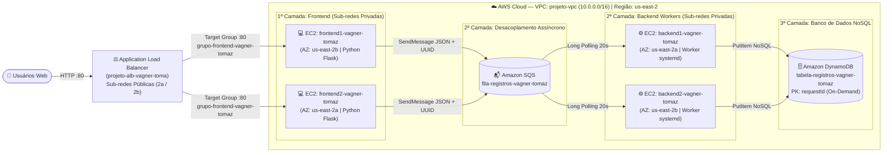

  <h1>🏗️ Dia 01 — Construindo a Solução</h1>
  <h3>Fundação da Arquitetura em 3 Camadas com Desacoplamento Assíncrono na AWS</h3>
  

    <a href="../README.md">⬅️ Voltar para a Página Principal</a> • 
    <a href="../dia-02/README.md">Avançar para o Dia 02: Evoluindo a Arquitetura ➡️</a>
  

---

## 🎯 Descrição Didática do Desafio (O Projeto do Dia 01)

Neste primeiro desafio da **Semana de Arquitetura AWS (Turma C9 SET - DPCN 17)**, sob orientação do **[Prof. Ednilson Cipolla](https://br.linkedin.com/in/ednilsoncipolla)** na **[Escola da Nuvem](https://escoladanuvem.org/)**, construímos a base de uma aplicação web corporativa dividida em **3 níveis lógicos (Apresentação, Mensageria/Processamento e Persistência)**.

**Por que usar essa arquitetura?**
Em sistemas legados ou que exigem processamento demorado, conectar o site diretamente ao banco de dados é um risco: se uma camada falhar ou lentificar, todo o sistema cai. Para resolver isso, introduzimos o **[Amazon SQS](https://aws.amazon.com/pt/sqs/)** entre o **Frontend** e o **Backend** (acoplamento fraco). O usuário envia uma mensagem pelo site, o servidor web deposita essa requisição na fila e libera o usuário imediatamente. Em segundo plano, os servidores de Backend leem a fila e salvam no **[Amazon DynamoDB](https://aws.amazon.com/pt/dynamodb/)**.

---

## 📐 Topologia da Arquitetura — Cenário Dia 01 (Mermaid.js)

---

## 🌐 Topologia e Endereçamento de Sub-redes

A rede `projeto-vpc` (`10.0.0.0/16`) em Ohio (`us-east-2`) foi segmentada em duas Zonas de Disponibilidade para garantir tolerância a falhas:

| Sub-rede | Zona (AZ) | Escopo | Roteamento de Saída (`0.0.0.0/0`) | Recursos Alocados |
| :--- | :---: | :---: | :--- | :--- |
| **Sub-rede Pública 1** | `us-east-2a` | Pública | [Internet Gateway (IGW)](https://docs.aws.amazon.com/pt_br/vpc/latest/userguide/VPC_Internet_Gateway.html) | Nó do ALB + NAT Gateway A |
| **Sub-rede Pública 2** | `us-east-2b` | Pública | [Internet Gateway (IGW)](https://docs.aws.amazon.com/pt_br/vpc/latest/userguide/VPC_Internet_Gateway.html) | Nó do ALB + NAT Gateway B |
| **Sub-rede Privada 1** | `us-east-2a` | Privada | [NAT Gateway A](https://docs.aws.amazon.com/pt_br/vpc/latest/userguide/vpc-nat-gateway.html) | `frontend2-vagner-tomaz` (Flask) |
| **Sub-rede Privada 2** | `us-east-2b` | Privada | [NAT Gateway B](https://docs.aws.amazon.com/pt_br/vpc/latest/userguide/vpc-nat-gateway.html) | `frontend1-vagner-tomaz` (Flask) |
| **Sub-rede Privada 3** | `us-east-2a` | Privada | [NAT Gateway A](https://docs.aws.amazon.com/pt_br/vpc/latest/userguide/vpc-nat-gateway.html) | `backend1-vagner-tomaz` (Worker) |
| **Sub-rede Privada 4** | `us-east-2b` | Privada | [NAT Gateway B](https://docs.aws.amazon.com/pt_br/vpc/latest/userguide/vpc-nat-gateway.html) | `backend2-vagner-tomaz` (Worker) |

---

## 🛠️ Tecnologias AWS Utilizadas e Glossário da Etapa

| Serviço AWS Oficial | Função Construída no Laboratório | Definição no Glossário |
| :--- | :--- | :--- |
| **[Amazon VPC](https://aws.amazon.com/pt/vpc/)** | Isolamento lógico da rede `projeto-vpc` em sub-redes públicas e privadas. | Rede virtual dedicada que isola a infraestrutura na nuvem. |
| **[Elastic Load Balancing (ALB)](https://aws.amazon.com/pt/elasticloadbalancing/application-load-balancer/)** | Recebe o acesso HTTP externo (`projeto-alb-vagner-toma`) e divide entre as instâncias. | Balanceador de carga de Camada 7 que distribui tráfego web entre múltiplas AZs. |
| **[Amazon EC2](https://aws.amazon.com/pt/ec2/)** | Hospedagem de 2 servidores Web (Frontend) e 2 processadores de fila (Backend). | Capacidade computacional segura e redimensionável na nuvem (IaaS). |
| **[AWS IAM](https://aws.amazon.com/pt/iam/)** | Role `ec2-role-vagner-tomaz` concedendo acesso seguro ao SQS e DynamoDB. | Serviço de controle de identidade e acesso baseado em políticas temporárias. |
| **[Amazon SQS](https://aws.amazon.com/pt/sqs/)** | Fila `fila-registros-vagner-tomaz` para desacoplar o envio da gravação final. | Serviço totalmente gerenciado de enfileiramento de mensagens para microsserviços. |
| **[Amazon DynamoDB](https://aws.amazon.com/pt/dynamodb/)** | Tabela `tabela-registros-vagner-tomaz` com chave `requestId` em modo On-Demand. | Banco de dados NoSQL gerenciado com latência de milissegundos em qualquer escala. |

---

## 🩺 Evidências de Testes de Integração e Troubleshooting Técnico

| Etapa / Desafio Enfrentado | Diagnóstico Técnico Realizado | Solução e Comprovação Obtida |
| :--- | :--- | :--- |
| **1. Validação de Security Groups Encadeados** | Instâncias em sub-redes privadas não devem responder diretamente à internet, apenas ao balanceador. | Configurado `ec2-sg-vagner-tomaz` aceitando porta `80` unicamente do grupo de origem `loadbalancer-sg-vagner-tomaz` (*Zero Direct Access*). |
| **2. Inicialização do User Data nas Sub-redes Privadas** | Instâncias privadas precisam baixar pacotes `python3-pip`, `flask` e `boto3` sem ter IP público. | Validado o roteamento de saída via **NAT Gateway** nas tabelas de rotas privadas; serviço `systemd` iniciado com sucesso. |
| **3. Sondas de Integridade do Target Group** | Alvos levam alguns segundos após o boot até que o servidor Flask responda `HTTP 200` na rota `/`. | Acompanhado o registro no `grupo-frontend-vagner-tomaz` até ambas as instâncias (`2a` e `2b`) atingirem o estado **Healthy**. |
| **4. Consumo e Exclusão no SQS** | Garantir que a mensagem não volte para a fila após ser gravada no DynamoDB. | Confirmada a execução do `sqs.delete_message(ReceiptHandle)` imediatamente após o `table.put_item()`, zerando a fila após o envio. |

---

## 🤔 Por que não usamos Terraform, CloudFormation ou Kiro no Dia 01?

* **Motivo Pedagógico:** Construir a fundação diretamente na console e via scripts *User Data* força o entendimento explícito do ciclo de rede (tabelas de rota, associação de sub-redes, Target Groups e IAM Instance Profiles).
* **Como essas ferramentas ajudariam neste cenário?**
  * **[Terraform](https://www.terraform.io/):** Permitiria declarar a VPC, o ALB, a fila SQS e a tabela DynamoDB em arquivos `.tf` reutilizáveis, provisionando toda a base com `terraform apply` em 3 minutos.
  * **[AWS CloudFormation](https://aws.amazon.com/pt/cloudformation/):** Criaria uma *Stack* nativa na AWS com rollback automático caso algum recurso falhasse na criação.
  * **Kiro:** Ajudaria a manter a especificação da arquitetura sincronizada com os scripts Python de Frontend e Backend.

---

## 🎯 Alinhamento e Cobertura [AWS SAA-C03](https://aws.amazon.com/pt/certification/certified-solutions-architect-associate/) — Dia 01

Distribuição do peso técnico abordado especificamente na construção do **Dia 01** conforme o [Guia do Exame SAA-C03](https://docs.aws.amazon.com/pt_br/aws-certification/latest/solutions-architect-associate-03/solutions-architect-associate-03.html):

| Domínio Oficial SAA-C03 | Cobertura no Dia 01 | Práticas e Melhores Práticas Aplicadas na Etapa |
| :--- | :---: | :--- |
| **Domínio 2: Arquiteturas Resilientes** *(Peso Oficial: 26%)* | **50%** | Distribuição Multi-AZ (`us-east-2a` e `us-east-2b`), balanceamento de carga com Health Checks e desacoplamento com fila Amazon SQS. |
| **Domínio 1: Arquiteturas Seguras** *(Peso Oficial: 30%)* | **20%** | Alocação de servidores exclusivamente em sub-redes privadas, Security Groups encadeados e uso de IAM Role sem chaves no código. |
| **Domínio 3: Alto Desempenho** *(Peso Oficial: 24%)* | **20%** | Arquitetura em 3 camadas, leitura eficiente com *Long Polling* (20s) e escrita NoSQL rápida no DynamoDB. |
| **Domínio 4: Custo Otimizado** *(Peso Oficial: 20%)* | **10%** | Uso de DynamoDB On-Demand (sem custo fixo ocioso) e redução de chamadas vazias de API na fila. |

---

## 🚀 Resumo de Boas Práticas e O que Deve Ser Melhorado (Gatilhos para o Dia 02)

* **Boas Práticas Conquistadas:** Isolamento de rede, ausência de credenciais AWS no código, acoplamento fraco via fila e banco gerenciado.
* **Pontos de Melhoria (Débitos Técnicos para o Dia 02):**
  1. **Dados Sensíveis no Script:** A URL da fila SQS e o nome da tabela DynamoDB estão fixos (*hardcoded*) dentro dos scripts Python.
  2. **Manutenção Manual:** Qualquer mudança exige recriar ou editar manualmente cada instância EC2.
  3. **Sem Recuperação Automática:** Se uma instância EC2 cair por falha ou pico de acesso, ela não volta sozinha (falta de Auto Scaling).

👉 **[Avançar para o Dia 02: Solucionando Segurança e Escalabilidade com Parameter Store e Auto Scaling ➡️](../dia-02/README.md)**