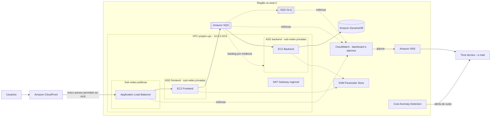

# Semana de Arquitetura AWS: construindo, evoluindo e operando uma aplicação web em 3 camadas

Em três dias de laboratório da **Escola da Nuvem**, parti de uma aplicação web simples e a transformei, passo a passo, em uma arquitetura distribuída em duas zonas de disponibilidade, desacoplada por fila, mais segura e observável. Este repositório documenta o que construí, **por que** cada decisão foi tomada, os erros que enfrentei e as melhorias que eu faria em produção.

**Autor:** Vagner Tomaz dos Santos · Analista de Infraestrutura de TI em transição para Arquitetura Cloud
**Região:** `us-east-2` (Ohio)

## Transparência: o que é do curso e o que é meu

O roteiro, os scripts e a conta do laboratório são da **Escola da Nuvem** (instrutor: Ednilson Cipolla) e não são reproduzidos aqui. Este repositório contém meu trabalho sobre o laboratório: diagramas, decisões (ADRs), evidências, análise crítica e melhorias.
A rede (VPC, sub-redes, Internet Gateway e NAT Gateway) já existia como pré-requisito ([baseline](docs/01-assessment.md)).

## A jornada em 3 etapas

| Etapa | O que mudou | Serviços principais | Página |
|---|---|---|---|
| **Dia 1: Construindo a base** | Aplicação de 3 camadas desacoplada por fila | EC2, ALB, SQS, DynamoDB, IAM | [dia-01](dia-01/README.md) |
| **Dia 2: Evoluindo a arquitetura** | Configuração fora do código, recuperação automática, acesso sem SSH | Parameter Store, ASG, Session Manager, CloudFront, DLQ | [dia-02](dia-02/README.md) |
| **Dia 3: Operando e testando** | Observabilidade, falhas provocadas, ALB protegido, escala por backlog | CloudWatch, SNS, Cost Anomaly Detection | [dia-03](dia-03/README.md) |

## Visão geral do ambiente (baseline)

| Item | Valor |
|---|---|
| Região / VPC | `us-east-2` · `projeto-vpc` (`10.0.0.0/16`) |
| Sub-redes | 2 públicas e 4 privadas, em 2 AZs |
| Fornecido pelo curso | VPC, sub-redes, Internet Gateway, NAT Gateway, conta restrita |
| Construído por mim | Tudo acima da rede: dados, fila, computação, balanceamento, segurança, operação |

## Arquitetura (estado final)



Os diagramas de cada etapa estão nas páginas dos dias. Boas práticas para os desenhos visuais: [diagrams/README.md](diagrams/README.md).

## Componentes em resumo

| Camada | Componente | Detalhe |
|---|---|---|
| Borda | CloudFront + ALB | Entrada única; o ALB só aceita o CloudFront (Dia 3) |
| Apresentação | EC2 Flask em Auto Scaling Group | Envia a requisição para a fila |
| Desacoplamento | SQS + DLQ | Absorve picos; isola mensagens com erro |
| Processamento | EC2 workers em Auto Scaling Group | Lê a fila, grava e apaga; escala por backlog |
| Persistência | DynamoDB | Chave `requestId` |
| Configuração e acesso | Parameter Store, Session Manager | Sem configuração no código e sem SSH |
| Operação | CloudWatch, SNS, Cost Anomaly Detection | Painel, alertas e custo |

Explicação camada a camada, glossário, checklist e melhorias: nas páginas de cada dia.

## Decisões de arquitetura (ADRs)

| ADR | Decisão |
|---|---|
| [0001](docs/03-adr/0001-sqs-entre-frontend-e-backend.md) | SQS entre frontend e backend |
| [0002](docs/03-adr/0002-dynamodb-para-persistencia.md) | DynamoDB para persistência |
| [0003](docs/03-adr/0003-parameter-store-para-configuracao.md) | Parameter Store para configuração |
| [0004](docs/03-adr/0004-escala-do-backend-por-backlog.md) | Escala do backend por backlog |
| [0005](docs/03-adr/0005-alb-acessivel-somente-via-cloudfront.md) | ALB acessível somente via CloudFront |
| [0006](docs/03-adr/0006-por-que-nao-usar-iac-neste-laboratorio.md) | Por que não usei infraestrutura como código |

## Aderência ao exame AWS SAA-C03 e a frameworks

- **Pontuação por domínio** (indicador didático próprio, com pesos oficiais 30/26/24/20): [docs/04](docs/04-saa-c03-scorecard.md).

| Cenário | Potencial | Declarado | Comprovado |
|---|---|---|---|
| Dia 1 | 32,3% | 28,3% | 3,2% |
| Dias 1+2 | 57,7% | 28,3% | 3,2% |
| Dias 1+2+3 | 72,0% | 28,3% | 3,2% |

*"Potencial" é o que o roteiro prevê; "Comprovado" só conta itens com evidência. Atualizo à medida que anexo as provas.*

- **Well-Architected, LGPD e CAF:** [docs/05](docs/05-frameworks.md). Não declaro conformidade com LGPD nem adoção do CAF; explico por quê.

## Evidências e troubleshooting

Política, legenda e modelo de registro de erros em [evidence/](evidence/README.md). Os prints do Dia 1 não foram salvos; o checklist daquele dia é registro textual (📝) e está identificado como tal.

## Estado do projeto

- [x] Estrutura, ADRs e documentação-base
- [ ] Dia 1: checklist registrado (📝)
- [ ] Dia 2: evidências
- [ ] Dia 3: Game Day e evidências
- [ ] Teardown: **somente após a ordem do professor**

## Estrutura do repositório

```text
├── README.md
├── dia-01/ dia-02/ dia-03/   # uma página por etapa
├── docs/                     # assessment, rede, ADRs, scorecard, frameworks, gestão
├── diagrams/                 # Mermaid (.mmd) e guia de boas práticas
├── evidence/                 # errors/ e tests/
├── terraform/                # reservado (não implementado)
├── scripts/                  # scorecard.py e criar-issues.sh
└── .github/                  # templates de issue/PR e workflow de qualidade
```

Como o projeto é gerido (Issues, Projects, Actions): [docs/06](docs/06-gestao-no-github.md).

## Créditos

Laboratório: **Escola da Nuvem**, instrutor **Ednilson Cipolla**.
