# Dia 1: Construindo a base, uma aplicação web em 3 camadas desacoplada

**Em uma frase:** um formulário web envia pedidos para uma fila, e trabalhadores independentes os gravam em um banco NoSQL, de modo que a falha de uma camada não derruba as outras.

> Laboratório da Escola da Nuvem. O roteiro e os scripts do curso não estão neste repositório. Aqui está o que **eu** entendi, validei e questiono.

## Objetivo do dia

Montar a arquitetura de 3 camadas sobre uma VPC já existente ([baseline](../docs/01-assessment.md)): DynamoDB, SQS, Security Groups, IAM Role, 2 EC2 de frontend, Target Group, ALB e 2 EC2 de backend.

## Tecnologias AWS desta etapa e suas funções

| Serviço | Função nesta etapa | Por que está aqui |
|---|---|---|
| **EC2** | Hospeda o frontend (Flask) e os workers do backend | Controle total sobre o servidor e a aplicação |
| **Application Load Balancer** | Recebe os usuários e distribui entre os frontends | Única porta de entrada pública e tolerância à queda de uma AZ |
| **Target Group** | Lista os frontends e verifica a saúde de cada um | O ALB só envia tráfego a destinos *healthy* |
| **Amazon SQS** | Fila entre frontend e backend | Desacopla as camadas e absorve picos |
| **Amazon DynamoDB** | Guarda as requisições a longo prazo | Banco NoSQL sem servidor para operar |
| **Security Groups** | Firewall por recurso | A EC2 só aceita tráfego vindo do ALB |
| **IAM Role / Instance Profile** | Dá às EC2 acesso ao SQS e ao DynamoDB | Credenciais temporárias, sem Access Keys no código |

## Glossário

| Termo | Significado simples |
|---|---|
| Multi-AZ | Recursos distribuídos em mais de uma Zona de Disponibilidade, para sobreviver à queda de uma |
| Sub-rede pública / privada | Pública tem rota para o Internet Gateway; privada não recebe conexões de entrada da internet |
| NAT Gateway (regional) | Permite que instâncias privadas saiam para a internet (instalar pacotes) sem serem acessíveis de fora; aqui há um só, regional |
| User Data | Script executado na primeira inicialização da instância |
| Long polling | O consumidor espera até 20 s por mensagens, reduzindo chamadas vazias |
| ReceiptHandle | "Recibo" usado para apagar a mensagem da fila após processá-la |
| Partition key | Chave que identifica cada item na tabela (`requestId`) |
| At-least-once | A fila garante entregar a mensagem pelo menos uma vez, podendo repetir |

## Topologia e endereçamento de sub-redes

VPC `projeto-vpc` (`10.0.0.0/16`), 2 sub-redes públicas e 4 privadas em 2 AZs. Detalhes e CIDRs em [docs/02-network-topology.md](../docs/02-network-topology.md).

| Sub-rede | Hospeda |
|---|---|
| public1 e public2 | ALB (e NAT) |
| private1 (us-east-2a) e private2 (us-east-2b) | Frontend, em AZs diferentes |
| private3 (us-east-2a) e private4 (us-east-2b) | Backend |

## Diagrama deste cenário

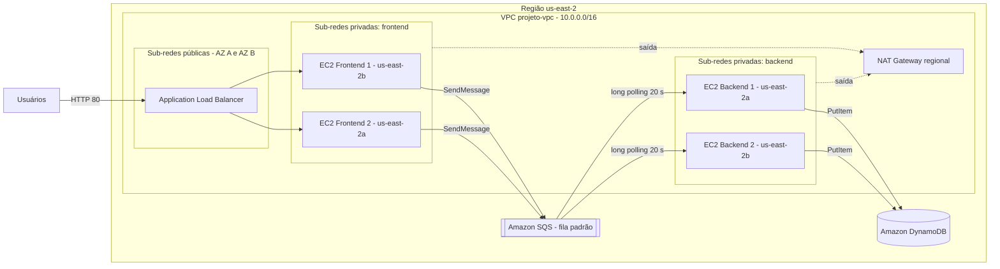

## Componentes da infraestrutura, camada a camada

- **Apresentação:** 2 EC2 com Flask atrás do ALB. Cada envio gera um `requestId` (UUID) e publica um JSON na fila.
- **Desacoplamento:** fila SQS padrão. O frontend responde ao usuário sem esperar o processamento.
- **Processamento:** 2 EC2 com um worker em `systemd` que lê a fila, grava no DynamoDB e só então apaga a mensagem.
- **Persistência:** tabela DynamoDB com chave `requestId`.
- **Segurança:** instâncias sem IP público; SG das EC2 aceita HTTP somente do SG do ALB; acesso aos serviços por Instance Profile.

## Fluxo de uma requisição

1. O usuário abre o DNS do ALB e envia o formulário.
2. O ALB encaminha a um frontend *healthy*.
3. O frontend publica a mensagem na SQS e responde com o `requestId`.
4. Um worker lê a mensagem (long polling).
5. O worker grava o item no DynamoDB.
6. O worker apaga a mensagem da fila.

## Checklist de validação

> Legenda em [evidence/](../evidence/README.md): 📸 comprovado com print, 📝 registro textual, 🔁 recaptura posterior. Os prints abaixo têm Account ID, usuário do console e DNS do ALB ocultados.

| Etapa | Verificação | Status |
|---|---|---|
| Baseline (VPC e rede) | `projeto-vpc` com 6 sub-redes em `us-east-2a` e `us-east-2b`, IGW, NAT regional e endpoint S3 | 📸 |
| DynamoDB | Tabela criada com chave `requestId` | 📝 |
| SQS | Fila criada e URL anotada localmente | 📝 |
| Security Groups | SG do ALB com HTTP 80 aberto a `0.0.0.0/0` | 📸 |
| Security Groups | SG das EC2 com HTTP vindo somente do SG do ALB | 📸 parcial (criação); **recapturar** as regras 🔁 |
| IAM | Role `ec2-role` criada em 04/11 (22:13) e política anexada | 📸 parcial; **recapturar** as permissões 🔁 |
| Frontend | 2 instâncias em AZs diferentes (`us-east-2a` e `us-east-2b`), sem IP público | 📸 |
| Target Group | 2 destinos *healthy*, um em cada AZ | 📸 |
| ALB | Ativo, *internet-facing*, 2 AZs, listener HTTP:80 → target group | 📸 |
| Teste do frontend | Página aberta e mensagem enviada, com `requestId` (dois envios) | 📸 |
| Backend | `backend1` em execução em `us-east-2a`; **`backend2` não aparece** na lista de instâncias | 📸 parcial (1 de 2) |
| Processamento | Mensagem removida da fila | 📝 |
| Persistência | Registro encontrado no DynamoDB | 📝 |

### Evidências anexadas

**Baseline fornecido pelo laboratório**

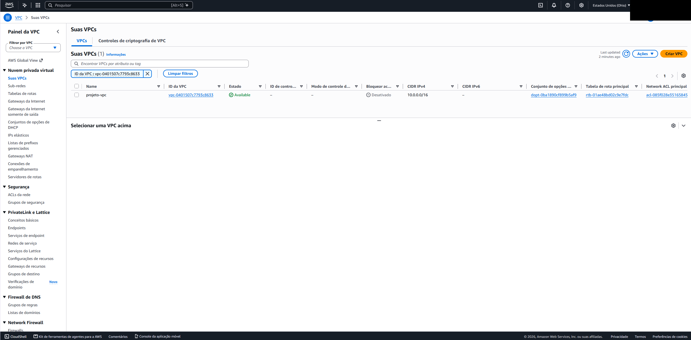

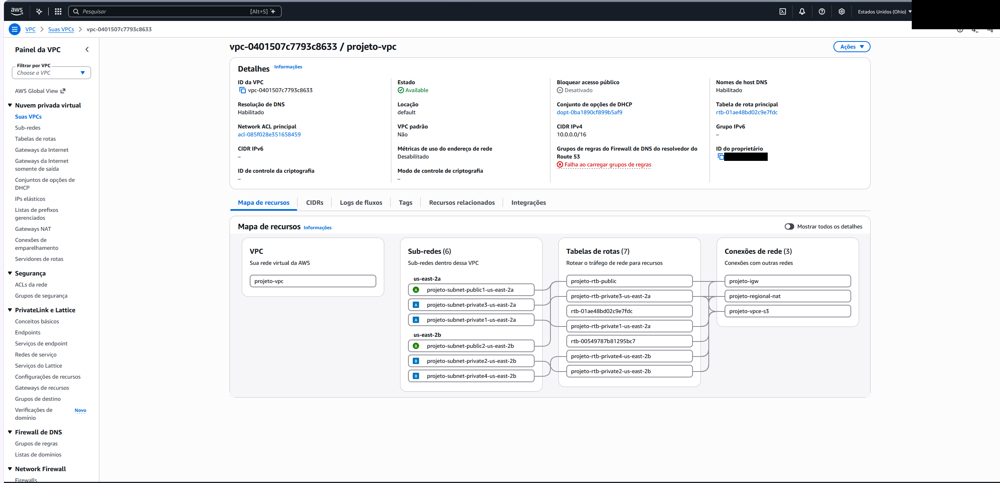

**Segurança**

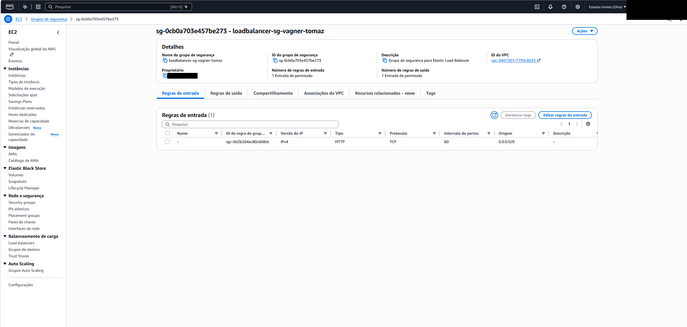

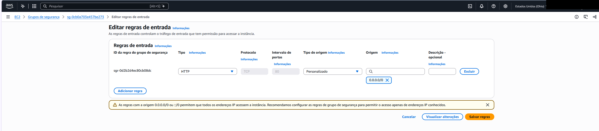

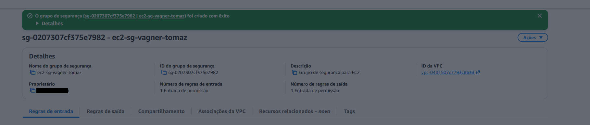

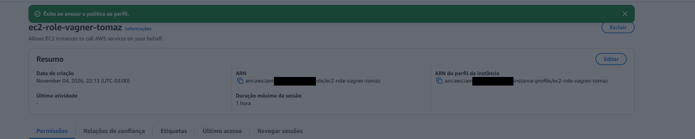

**Computação, balanceamento e teste**

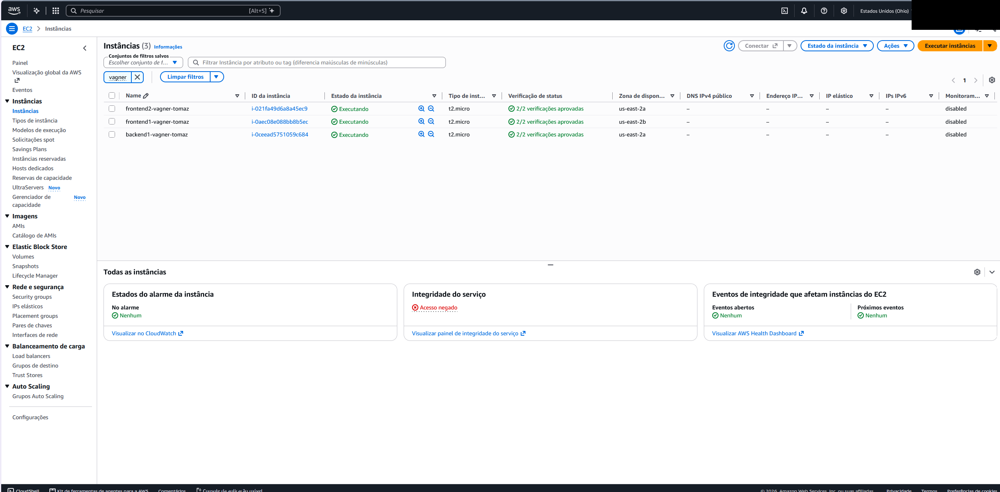

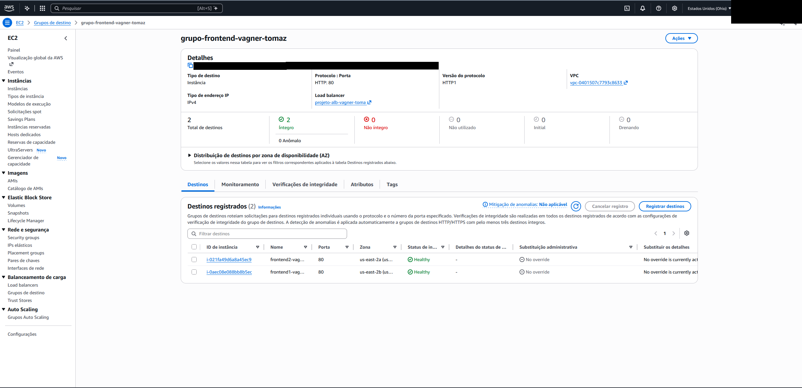

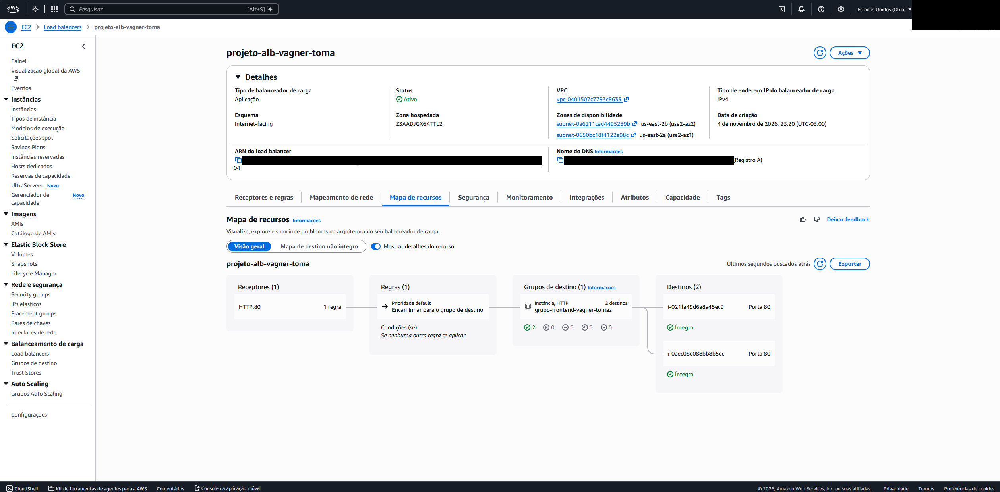

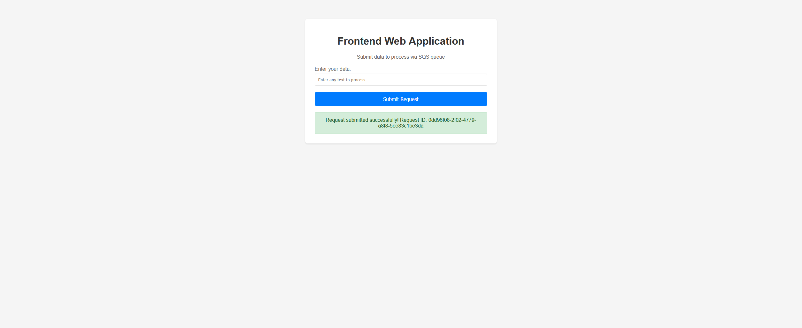

A aplicação exibe erro quando o envio à fila falha, então a mensagem de sucesso indica que a publicação no SQS e a permissão da role funcionaram. Isso **não** prova que o backend processou a mensagem: para isso falta o item no DynamoDB.

### Pontos que as evidências levantam

- **Backend:** a lista mostra `frontend1`, `frontend2` e `backend1`. O Dia 1 pede dois backends; confirmar se `backend2` foi encerrado conforme o roteiro ou se não foi criado. Isso afeta a afirmação de "backend em 2 AZs".
- **Role:** o print `Role-VagnerSantos` (AmazonS3FullAccess, criada em 05/10) é de **outro laboratório** e não comprova o Dia 1. A role do Dia 1 é `ec2-role-…`. Esse print **não deve ser publicado**: mostra o Account ID, o usuário do console e um link de troca de função.

### Recaptura pendente (ambiente ativo)

- [ ] SG das EC2 (`ec2-sg`): aba *Regras de entrada*, com a origem apontando para o SG do ALB.
- [ ] Role `ec2-role`: aba *Permissões*, com as políticas anexadas (`FullAccess` de DynamoDB e SQS).
- [ ] DynamoDB: *Explorar itens* procurando o `requestId` `c4c76b46-581e-45d7-97cd-154c48209f1a` (o do segundo envio). Se o item existir, é a prova de persistência.
- [ ] SQS: aba *Monitoramento* da fila.
- [ ] Situação do `backend2`.
- [ ] Originais sem tarja em `evidence/_originais/`.

## Dificuldades encontradas

<!-- TODO: registre aqui as suas dificuldades reais, um item por linha, e crie um arquivo em evidence/errors/ para as principais. -->

| Dificuldade | Causa | Como resolvi | Registro |
|---|---|---|---|
| TODO | | | |

**Pontos de atenção que o próprio roteiro aponta** (não são necessariamente os meus): destinos *unhealthy* geralmente indicam regra de Security Group incorreta ou instância sem o SG; a região e a URL da fila precisam ser editadas no script antes de colar no *User Data*.

## Pontuação SAA-C03 deste dia

Potencial do Dia 1: **32,3%** (declarado: 28,3%). Método em [docs/04](../docs/04-saa-c03-scorecard.md).

## O que eu melhoraria

| Melhoria | Por quê |
|---|---|
| Políticas IAM restritas por recurso, e roles separadas para frontend e backend | O roteiro usa `FullAccess`; o frontend só precisa de `SendMessage` |
| Um Security Group por camada | Backend não precisa receber HTTP |
| HTTPS no ALB (ACM) | Hoje o tráfego é HTTP |
| DLQ na fila | Evita mensagens com erro em ciclo (Dia 2) |
| Auto Scaling | Substituir instâncias que falham (Dia 2) |
| Configuração fora do código | Evita reimplantar a cada mudança (Dia 2) |
| VPC endpoints para SQS e DynamoDB | Reduz dependência e custo do NAT Gateway |
| Habilitar PITR no DynamoDB | Backup contínuo |

IaC (Terraform/CloudFormation) e por que não foi usado: [ADR-0006](../docs/03-adr/0006-por-que-nao-usar-iac-neste-laboratorio.md).

## Resumo para a documentação

Foi construída uma aplicação de 3 camadas com frontend e backend em duas AZs, desacoplados por SQS e persistindo em DynamoDB, exposta apenas pelo ALB. A arquitetura é resiliente à queda de uma instância ou de uma AZ na camada web, mas ainda tem pontos fracos conhecidos (permissões amplas, HTTP, configuração fixa no código e ausência de substituição automática), tratados nos dias seguintes.
