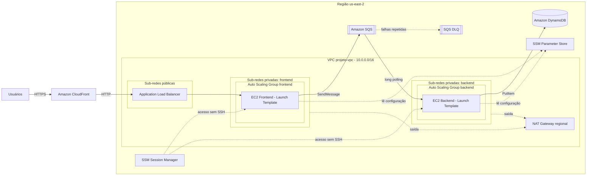

# Dia 2: Evoluindo a arquitetura, segurança e elasticidade

**Em uma frase:** tirar a configuração do código, permitir que a infraestrutura se recupere sozinha e fechar acessos desnecessários, aceitando alguns compromissos que este laboratório deixa explícitos.

> Laboratório da Escola da Nuvem. Roteiro e scripts do curso não estão neste repositório.

## Problemas herdados do Dia 1

| Problema | Consequência |
|---|---|
| Região, URL da fila e nome da tabela fixos no código | Qualquer mudança exige editar e reimplantar em cada instância |
| Instância que cai (aplicação, AZ ou carga) não volta | Capacidade perdida até alguém intervir |
| Acesso administrativo dependente de SSH | Porta aberta e chaves para gerir |

## Tecnologias AWS desta etapa e suas funções

| Serviço | Função | Configuração aplicada no laboratório | Resolve |
|---|---|---|---|
| **SSM Parameter Store** | Guarda a configuração fora do código | 3 parâmetros do tipo `String` em `/projeto/<nome>/…`: região, URL da fila e nome da tabela | Configuração fixa |
| **IAM (role existente)** | Dá à instância acesso ao Systems Manager | Anexadas `AmazonSSMManagedInstanceCore` (Session Manager) e `AmazonSSMReadOnlyAccess` (ler parâmetros) | Permissões novas, sem chaves |
| **SSM Session Manager** | Terminal remoto sem SSH aberto | Sem porta 22, sem IP público, sem par de chaves | Acesso inseguro |
| **Launch Template** | Molde da instância (AMI, SG, role, User Data) | Um para frontend e outro para backend, `t2.micro`, sem par de chaves | Instâncias manuais e diferentes entre si |
| **Auto Scaling Group** | Mantém e substitui instâncias | Mínimo 1, desejado 1, máximo 2, por camada; política de CPU média em 60%; frontend atrelado ao target group com health check do ELB; backend sem load balancer | Recuperação e elasticidade |
| **Amazon CloudFront** | Distribuição de borda na frente do ALB | Plano *pay as you go*; origem = ALB; **HTTP** entre CloudFront e ALB; WAF desativado por custo | Entrega otimizada e HTTPS ao usuário |
| **SQS Dead Letter Queue** | Fila para mensagens que falham | Retenção 14 dias; visibilidade 30 s; **máximo de 3 recebimentos** na fila principal | Nenhuma mensagem perdida |

## Glossário

| Termo | Significado simples |
|---|---|
| Launch Template | Receita da instância usada pelo ASG |
| Desired / Min / Max | Quantidade desejada, mínima e máxima de instâncias no ASG |
| Target tracking | Política que ajusta a capacidade para manter uma métrica próxima de uma meta (aqui, CPU em 60%) |
| Health check do ELB | O ASG considera a instância não saudável se o load balancer a marcar assim, e a substitui |
| Parameter Store | Repositório de parâmetros da aplicação (`String`, lista ou `SecureString` criptografado com KMS) |
| Session Manager | Sessão de terminal via Systems Manager, sem porta 22 |
| Visibility timeout | Tempo em que a mensagem fica invisível para outros consumidores enquanto é processada |
| DLQ / maxReceiveCount | Fila de mensagens "mortas" / número de tentativas antes de a mensagem ser enviada para ela |
| Redrive | Devolver à fila principal as mensagens que estavam na DLQ, depois de corrigir a causa |

## Topologia deste cenário

As sub-redes são as mesmas do Dia 1 ([docs/02](../docs/02-network-topology.md)). O frontend ocupa `private1` e `private2`, e o backend `private3` e `private4`.

## Como o laboratório trata a mudança (resumo)

1. As instâncias do Dia 1 são religadas para criar os parâmetros e abrir sessões pelo Session Manager.
2. O código de frontend e backend é editado **manualmente, dentro das instâncias**, para ler os parâmetros e reiniciar o serviço.
3. Aplicação testada de ponta a ponta (fila esvazia, item aparece no DynamoDB).
4. As instâncias manuais são **excluídas** e substituídas por Launch Templates e ASGs.
5. CloudFront e DLQ são criados, e o roteiro propõe um **teste guiado de falha** (abaixo).

## Teste guiado de falha (parte do roteiro)

Sequência: interromper a instância de backend → enviar a mensagem `teste-sqs-dlq` pelo site → observar a mensagem voltar à fila a cada 30 s → após 3 recebimentos, vê-la chegar à DLQ → conferir se o ASG criou outra instância → devolver a mensagem à fila principal (*redrive*).

É um mini Game Day. Os resultados observados vão para a tabela do [Dia 3](../dia-03/README.md), sem repetir aqui.

## Checklist de validação

<!-- TODO: marque 📸 quando tiver print/log, 📝 se foi executado sem print, 🔁 se refez a captura depois (com a data). -->

| Etapa | Verificação | Status |
|---|---|---|
| Parameter Store | 3 parâmetros criados com os nomes usados no código | TODO |
| IAM | `AmazonSSMManagedInstanceCore` e `AmazonSSMReadOnlyAccess` anexadas | TODO |
| Session Manager | Sessão aberta em uma instância, sem SSH | TODO |
| Código | Aplicação sem URL de fila/tabela fixa; `systemctl status` ativo | TODO |
| Teste ponta a ponta | Mensagem processada e item no DynamoDB | TODO |
| Launch Templates | Frontend e backend criados | TODO |
| Auto Scaling | ASG frontend e backend (min 1, desired 1, max 2, CPU 60%) | TODO |
| Substituição | Instância interrompida e substituída pelo ASG | TODO |
| CloudFront | Distribuição *Deployed* respondendo em HTTPS | TODO |
| DLQ | Mensagem `teste-sqs-dlq` chegando à DLQ após 3 recebimentos | TODO |
| Redrive | Mensagem devolvida à fila principal e processada | TODO |
| Desafio opcional | Acesso direto ao ALB bloqueado (ou deixado para o Dia 3) | TODO |

## Dificuldades encontradas

<!-- TODO: erros reais (permissão IAM, parâmetro não encontrado, instância não aparece no Session Manager, health check, etc.) e arquivos em evidence/errors/. -->

| Dificuldade | Causa | Como resolvi | Registro |
|---|---|---|---|
| TODO | | | |

**Ponto de atenção que o próprio roteiro aponta** (não é necessariamente o meu): se a instância não aparece no Session Manager, aguardar cerca de 2 minutos para a política IAM propagar ou reiniciá-la.

## Pontuação SAA-C03

Potencial acumulado dos Dias 1+2: **57,7%** (+25,3 pontos sobre o Dia 1). Método em [docs/04](../docs/04-saa-c03-scorecard.md).

## Análise crítica: o que o Dia 2 resolve e o que deixa em aberto

| Observação | Por que importa | Como tratar |
|---|---|---|
| **Mínimo e desejado = 1 por camada** | No Dia 1 havia 2 instâncias por camada. Em regime normal, agora há **uma**, e a recuperação depende de o ASG criar outra (minutos de indisponibilidade). A disponibilidade passa de redundância para recuperação | Mínimo 2 por camada, uma em cada AZ, para eliminar o ponto único de falha |
| **Parâmetros lidos na inicialização** | O código lê o Parameter Store ao subir. Mudar um parâmetro só vale após reiniciar o serviço ou substituir a instância, ao contrário do que "sem reimplantar" sugere | Cache com expiração, ou *instance refresh* controlado |
| **Região e caminho ainda no código** | O cliente do SSM precisa da região, e o prefixo `/projeto/<nome>/` também fica no código. A externalização é parcial | Região via variável de ambiente ou metadados da instância; prefixo via variável |
| **`String`, não `SecureString`** | URL da fila e nome da tabela são configuração, não segredo, então `String` é aceitável. O roteiro justifica não usar KMS pelo custo. Para segredos reais, não serve | `SecureString` com KMS ou Secrets Manager |
| **`AmazonSSMReadOnlyAccess` é ampla** | Dá leitura sobre o Systems Manager inteiro, e a role ainda tem `FullAccess` de SQS e DynamoDB | Política própria com `ssm:GetParameter` somente no caminho da aplicação |
| **CloudFront → ALB em HTTP e sem WAF** | Tráfego sem TLS na origem; WAF desativado por custo | HTTPS ponta a ponta (ACM) e WAF quando houver orçamento |
| **ALB ainda acessível diretamente** | Contorna o CloudFront. O roteiro propõe como desafio opcional e fecha no Dia 3 | [ADR-0005](../docs/03-adr/0005-alb-acessivel-somente-via-cloudfront.md) |
| **Backend escala por CPU** | Um consumidor de fila pode ter CPU baixa com a fila crescendo | Escala por backlog, no Dia 3 ([ADR-0004](../docs/03-adr/0004-escala-do-backend-por-backlog.md)) |
| **Edição manual dentro das instâncias** | Gera divergência entre instâncias; os templates corrigem | Launch Template como fonte única |

## O que eu melhoraria

| Melhoria | Por quê |
|---|---|
| Mínimo 2 instâncias por camada | Remove o ponto único de falha em regime normal |
| Política IAM restrita ao caminho dos parâmetros | Menor privilégio |
| Parâmetros como `SecureString` e leitura com cache | Segurança e atualização sem reiniciar |
| HTTPS entre CloudFront, ALB e instâncias; WAF | Proteção da entrada |
| Alarme para a profundidade da DLQ | Avisar quando há falhas (Dia 3) |
| Instâncias de geração mais recente (por exemplo, `t3`) | Custo e desempenho; confirmar preços atuais antes de afirmar |

IaC e por que não foi usado: [ADR-0006](../docs/03-adr/0006-por-que-nao-usar-iac-neste-laboratorio.md).

## Resumo para a documentação

O Dia 2 resolve os débitos do Dia 1: a configuração sai do código (Parameter Store), as instâncias passam a ser descartáveis e substituíveis (Launch Template e ASG), o acesso administrativo não depende de SSH (Session Manager), e falhas de processamento ficam isoladas na DLQ após três tentativas. Em troca, a capacidade em regime normal cai para uma instância por camada, e a externalização da configuração é parcial. <!-- TODO: ajuste para o que de fato foi concluído. -->
