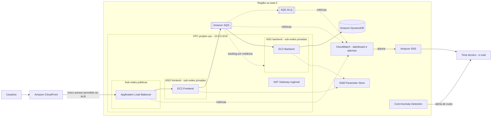

# Dia 3: Operando a arquitetura, observabilidade, falhas controladas e custo

**Em uma frase:** a arquitetura já existe; agora eu a observo, provoco falhas de propósito, vejo o que acontece sozinho e corrijo o que faz sentido.

> Laboratório da Escola da Nuvem. Roteiro e scripts do curso não estão neste repositório.

## Objetivo do dia

Tornar a operação visível (painel e alertas), fechar a brecha do ALB aberto, escalar o backend pelo trabalho pendente e **comprovar** a resiliência com testes de falha.

## Tecnologias AWS desta etapa e suas funções

| Serviço | Função |
|---|---|
| **CloudWatch Dashboard** | Painel unificado com métricas do ALB, dos ASGs e da fila SQS |
| **CloudWatch Alarms + SNS** | Alarme dispara e o SNS envia e-mail |
| **Security Group do ALB** | Restrito ao CloudFront, fechando o acesso direto |
| **Auto Scaling por backlog** | Escala o consumidor pelo volume de mensagens por instância |
| **Run Command (SSM)** | Executar comandos nas instâncias sem acesso remoto direto |
| **Cost Anomaly Detection** | Alerta de gastos fora do padrão |

## Glossário

| Termo | Significado simples |
|---|---|
| Métrica / Alarme | Medida ao longo do tempo / regra que dispara uma ação ao ultrapassar um limite |
| Tópico SNS / Assinatura | Canal de notificação / destino (e-mail) inscrito nele |
| Backlog por instância | Mensagens pendentes divididas pelo número de instâncias que as processam |
| ApproximateNumberOfMessagesVisible | Métrica do SQS com o total de mensagens aguardando |
| Game Day | Exercício em que provocamos falhas para observar a resposta do sistema |
| Auto-healing | Substituição automática de componentes com falha |

## Diagrama deste cenário

## Componentes da infraestrutura

- **Observabilidade:** dashboard (ALB, ASG, SQS) e alarmes. 
- **Segurança:** ALB acessível somente via CloudFront. [ADR-0005](../docs/03-adr/0005-alb-acessivel-somente-via-cloudfront.md).
- **Escala por backlog:** [ADR-0004](../docs/03-adr/0004-escala-do-backend-por-backlog.md).
- **Custo:** Cost Anomaly Detection.

## Game Day: falhas provocadas

<!-- TODO: preencha com o que você realmente fez e mediu. Não registre resultado que não observou. -->
> O Dia 2 já inclui uma versão guiada das falhas 2 e 4 (parar o backend, enviar `teste-sqs-dlq` e acompanhar a DLQ). Se você a executou, reaproveite as evidências e registre também o tempo de recuperação.

| # | Falha provocada | Esperado | Observado | Tempo medido | Evidência | Ação corretiva |
|---|---|---|---|---|---|---|
| 1 | Encerrar uma instância de frontend | ASG substitui; site segue disponível | TODO | TODO | TODO | TODO |
| 2 | Encerrar uma instância de backend | ASG substitui; fila não perde mensagens | TODO | TODO | TODO | TODO |
| 3 | Parar o backend e enviar várias mensagens | Backlog cresce e dispara a escala | TODO | TODO | TODO | TODO |
| 4 | Mensagem inválida | Vai para a DLQ e dispara alarme | TODO | TODO | TODO | TODO |
| 5 | Acessar o ALB direto, fora do CloudFront | Acesso bloqueado | TODO | | TODO | TODO |

## Checklist de validação

| Etapa | Verificação | Status |
|---|---|---|
| Dashboard | Métricas de ALB, ASG e SQS | TODO |
| Alarme + SNS | E-mail recebido ao disparar | TODO |
| Restrição do ALB | Acesso direto negado e via CloudFront permitido | TODO |
| Escala por backlog | Novas instâncias com a fila cheia | TODO |
| Cost Anomaly Detection | Monitor configurado | TODO |

## Dificuldades encontradas

| Dificuldade | Causa | Como resolvi | Registro |
|---|---|---|---|
| TODO | | | |

## Pontuação SAA-C03

Potencial acumulado dos Dias 1+2+3: **72,0%** (+14,3 pontos sobre o Dia 2). O restante são lacunas conhecidas. Método em [docs/04](../docs/04-saa-c03-scorecard.md).

## O que eu melhoraria

| Melhoria | Por quê |
|---|---|
| Alarmes para DLQ e idade da mensagem mais antiga | Detectar falhas silenciosas |
| Cabeçalho secreto CloudFront→ALB e WAF | Reforçar a proteção da entrada |
| Logs estruturados e centralizados | Diagnóstico mais rápido |
| Runbooks por alarme | Resposta consistente |
| Teste de carga com métricas (latência, vazão) | Calibrar a escala com dados |
| Estimativa de custo e avaliação de VPC endpoints vs NAT | Custo previsível |
| Infraestrutura como código | Reprodutibilidade ([ADR-0006](../docs/03-adr/0006-por-que-nao-usar-iac-neste-laboratorio.md)) |

## Resumo para a documentação

O Dia 3 muda o foco de construir para operar: painel e alertas tornam o sistema observável, o ALB deixa de ser acessível diretamente, o backend escala pelo trabalho pendente, e testes de falha comprovam o comportamento. <!-- TODO: ajuste para o que de fato foi concluído e medido. -->

## Limpeza do ambiente

Os recursos dos Dias 1 a 3 **não serão removidos** até a entrega final e a ordem do professor. Antes do teardown: concluir as evidências, atualizar o [scorecard](../docs/04-saa-c03-scorecard.md) e registrar a ordem recebida.
