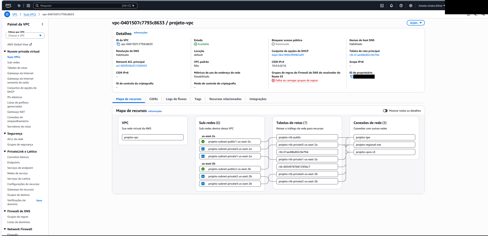

# 02 · Topologia de rede e endereçamento

> A VPC e seus componentes de rede foram fornecidos pelo laboratório (ver [baseline](01-assessment.md)). Aqui documento o que **li e entendi** do ambiente.

## Visão geral

| Item | Valor | Evidência |
|---|---|---|
| Região | `us-east-2` (Ohio) | 📸 |
| VPC | `projeto-vpc`, `10.0.0.0/16` | 📸 [lista](../evidence/dia-01/dia1-vpc-lista.png) |
| Zonas de disponibilidade | `us-east-2a` e `us-east-2b` | 📸 [mapa de recursos](../evidence/dia-01/dia1-vpc-mapa-de-recursos.png) |
| Conexões de rede (3) | `projeto-igw` (Internet Gateway), `projeto-regional-nat` (**NAT Gateway regional, um só**) e `projeto-vpce-s3` (endpoint para o S3; confirmar o tipo no console) | 📸 mesmo mapa |

## Sub-redes

<!-- TODO: preencher os CIDRs em VPC > Sub-redes (apenas leitura, não gera custo) -->

| Nome no console | Tipo | AZ | Recurso que hospeda | CIDR |
|---|---|---|---|---|
| `projeto-subnet-public1-us-east-2a` | Pública | us-east-2a | ALB | TODO |
| `projeto-subnet-public2-us-east-2b` | Pública | us-east-2b | ALB | TODO |
| `projeto-subnet-private1-us-east-2a` | Privada | us-east-2a | Frontend | TODO |
| `projeto-subnet-private2-us-east-2b` | Privada | us-east-2b | Frontend | TODO |
| `projeto-subnet-private3-us-east-2a` | Privada | us-east-2a | Backend | TODO |
| `projeto-subnet-private4-us-east-2b` | Privada | us-east-2b | Backend | TODO |

## Rotas

O mapa mostra 7 tabelas de rotas: `projeto-rtb-public`, uma por sub-rede privada (`projeto-rtb-private1…4`, cada uma na sua AZ) e 2 tabelas sem nome (a principal da VPC e outra).

| Tabela de rotas | Rota padrão (`0.0.0.0/0`) | Por quê |
|---|---|---|
| `projeto-rtb-public` | Internet Gateway | O ALB precisa receber tráfego da internet |
| `projeto-rtb-private1…4` | NAT Gateway regional | As instâncias instalam pacotes sem receber conexões de entrada |

<!-- TODO: confirmar os destinos das rotas em VPC > Tabelas de rotas (o mapa mostra as associações, não os destinos) -->

## Security Groups

| SG | Entrada | Origem | Observação |
|---|---|---|---|
| ALB | HTTP 80 | `0.0.0.0/0` | Dia 3: restringir ao CloudFront |
| EC2 | HTTP 80 | SG do ALB | Mesmo SG para frontend e backend (melhoria: separar) |

## Serviços regionais fora da VPC

SQS, DynamoDB, Systems Manager e CloudWatch são **serviços regionais**: não ficam "dentro" da VPC. As instâncias os acessam pelo NAT Gateway regional. A VPC já tem um endpoint para o S3 (`projeto-vpce-s3`); como melhoria, endpoints para SQS, DynamoDB e SSM reduziriam a dependência do NAT. Nos diagramas, desenhe-os fora do retângulo da VPC.
