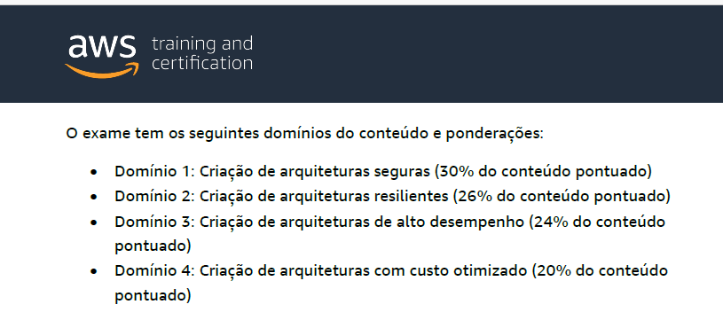

# 04 · Pontuação por domínios do SAA-C03

> **Indicador didático próprio.** Não é a nota do exame nem uma auditoria. Serve para mostrar quanto de cada domínio o projeto cobre e como isso evolui a cada dia.

## Método

1. Cada domínio tem uma lista de práticas observáveis (arquivo [`saa-c03-scorecard.csv`](saa-c03-scorecard.csv)).
2. Cada prática pertence ao dia que a introduz. As **lacunas** (dia `0`) são melhorias que o laboratório não cobre e **contam no total**, então nenhum domínio chega a 100% por padrão.
3. Pontuação = soma, por domínio, de `peso × (itens cobertos ÷ itens totais)`.
4. Três visões, para não confundir o que foi feito com o que foi provado:

| Visão | Conta itens com status |
|---|---|
| Comprovado | `ok` (com evidência) |
| Declarado | `ok` + `registrado` (executado, sem print) |
| Potencial | `ok` + `registrado` + `pendente` (previsto no roteiro) |

Pesos oficiais dos domínios: Seguro **30%** · Resiliente **26%** · Alto desempenho **24%** · Custo otimizado **20%**.

Fonte: [página oficial do exame AWS Certified Solutions Architect - Associate](https://aws.amazon.com/pt/certification/certified-solutions-architect-associate/) e o [guia do exame SAA-C03](https://docs.aws.amazon.com/pt_br/aws-certification/latest/solutions-architect-associate-03/solutions-architect-associate-03.html). Captura da página: 

## Resultado atual (rode `python3 scripts/scorecard.py` para atualizar)

| Cenário | Comprovado | Declarado | Potencial |
|---|---|---|---|
| Dia 1: Construindo a solução | 3,2% | 28,3% | 32,3% |
| Dias 1+2: Evoluindo a arquitetura | 3,2% | 28,3% | 57,7% |
| Dias 1+2+3: Operação e resiliência | 3,2% | 28,3% | 72,0% |

O "potencial" de 72,0% no fim do Dia 3 é o teto realista do **laboratório como está**. Os 28,0% restantes são as lacunas (menor privilégio, HTTPS, mínimo de 2 instâncias por camada, backup, teste de carga medido, estimativa de custo, teardown, VPC endpoints) e formam o roteiro de melhorias.

## Como evoluir a pontuação

- Troque `pendente` por `ok` quando houver evidência em `evidence/`.
- Troque `registrado` por `ok` se conseguir refazer a captura (registrando a data).
- Se implementar uma melhoria (por exemplo, políticas IAM restritas), mude `lacuna` para `ok` **e o dia** de `0` para o dia em que foi feita.
