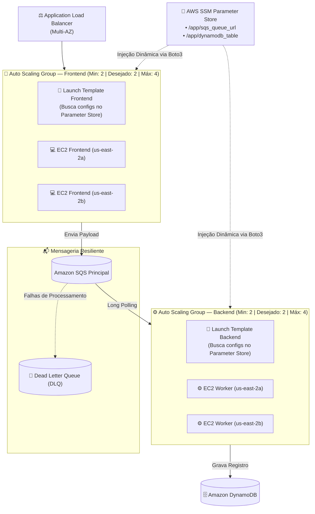

# 🛡️ Dia 02 — Evoluindo a Arquitetura: Segurança com Parameter Store e Elasticidade com Auto Scaling

[⬅️ Voltar para o Dia 01](../dia-01/README.md) | [🏠 Página Principal](../README.md) | [Avançar para o Dia 03: Operação e Resiliência ➡️](../dia-03/README.md)

---

## 🎯 Descrição e Objetivo Pedagógico da Etapa

No **Dia 02**, resolvemos os débitos técnicos de segurança, governança e disponibilidade identificados na fundação do projeto:
1. **Remoção de Dados Hardcoded:** Extraímos a URL da fila SQS e o nome da tabela DynamoDB de dentro do código Python e os armazenamos de forma centralizada e segura no **AWS Systems Manager Parameter Store**.
2. **Gerenciamento Zero-SSH:** Habilitamos o **AWS Systems Manager Session Manager**, permitindo acesso administrativo ao terminal das instâncias privadas diretamente pelo navegador/CLI com auditoria IAM, sem abrir a porta 22 (SSH) e sem usar chaves `.pem`.
3. **Resiliência e Autoescalonamento:** Substituímos as instâncias manuais por **Launch Templates** (modelos de inicialização padronizados) gerenciados por **Auto Scaling Groups (ASG)** para o Frontend e para o Backend, garantindo reposição automática em caso de falha e criação de uma **Dead Letter Queue (DLQ)** no SQS.

---

## 📐 Topologia Evoluída — Cenário Dia 02

---

## 🛠️ Tecnologias Adicionadas no Dia 02 e Glossário

| Serviço / Recurso | Função Prática no Dia 02 | Conceito de Glossário |
| :--- | :--- | :--- |
| **SSM Parameter Store** | Guarda a URL da fila SQS e o nome da tabela DynamoDB fora do código da aplicação. | Repositório hierárquico gerenciado para armazenamento seguro de parâmetros e segredos. |
| **SSM Session Manager** | Permite abrir um terminal seguro nas EC2 privadas sem precisar de IP público ou porta 22. | Funcionalidade do Systems Manager para acesso remoto auditável via túnel seguro do agente SSM. |
| **Launch Template** | Define a receita padrão da máquina (AMI Amazon Linux 2023, tipo `t2.micro`, IAM Role, SG e User Data). | Modelo imutável e versionado que especifica como novas instâncias EC2 devem ser provisionadas. |
| **Auto Scaling Group (ASG)** | Mantém sempre o número desejado de máquinas no ar e substitui instâncias defeituosas sozinho. | Serviço que gerencia frotas de EC2, ajustando a capacidade horizontalmente conforme políticas definidas. |
| **Dead Letter Queue (DLQ)** | Recebe mensagens que falharam repetidamente para não travar a fila principal. | Fila secundária usada para isolar mensagens não processadas para posterior depuração. |

---

## 🩺 Registro de Troubleshooting do Dia 02

| Problema Enfrentado | Causa Raiz | Solução Aplicada |
| :--- | :--- | :--- |
| **Erro `AccessDeniedException` ao chamar `ssm:GetParameter`** | A IAM Role criada no Dia 01 tinha permissão apenas para SQS e DynamoDB. | Adicionada a permissão de leitura ao Parameter Store (`AmazonSSMReadOnlyAccess` / `AmazonSSMManagedInstanceCore`) na role `ec2-role-vagner-tomaz`. |
| **Novas instâncias do ASG do Frontend não recebem tráfego do ALB** | O Auto Scaling Group subiu as máquinas, mas não estava vinculado ao Target Group do balanceador. | Configurada a integração de Load Balancing no ASG associando-o diretamente ao `grupo-frontend-vagner-tomaz` e habilitando os *ELB Health Checks*. |

---

## 🚀 O que Pode Ser Melhorado? (Gatilhos para o Dia 03)

A arquitetura agora é segura e elástica, mas ainda carece de **visibilidade operacional e validação sob fogo real**:
1. Como acompanhar todas as camadas (ALB, ASG e SQS) em uma única tela sem navegar por vários menus do console?
2. Como escalar os Workers de Backend com base no acúmulo real de mensagens na fila (*Backlog*) em vez de olhar apenas para uso de CPU?
3. Como provar que o Auto Scaling realmente recupera o ambiente quando máquinas são destruídas?

👉 **[Clique aqui para avançar para o Dia 03: Operação, Observabilidade e Engenharia do Caos ➡️](../dia-03/README.md)**