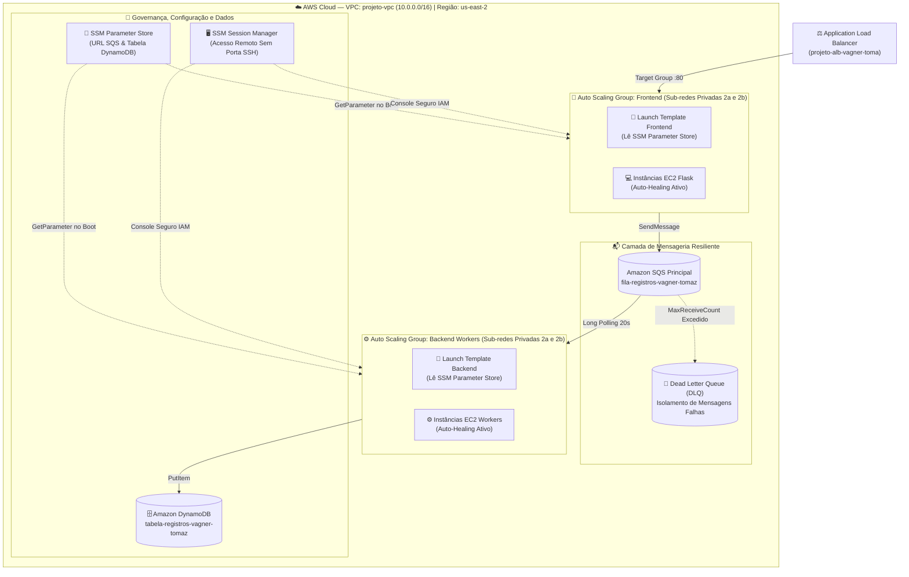

  <h1>🛡️ Dia 02 — Evoluindo a Arquitetura</h1>
  <h3>Segurança Centralizada com Parameter Store, Acesso Zero-SSH e Elasticidade com Auto Scaling</h3>
  

    <a href="../dia-01/README.md">⬅️ Voltar para o Dia 01</a> • 
    <a href="../README.md">🏠 Página Principal</a> • 
    <a href="../dia-03/README.md">Avançar para o Dia 03: Operação e Resiliência ➡️</a>
  

---

## 🎯 Descrição Didática do Desafio (O Projeto do Dia 02)

No **Dia 02**, evoluímos a arquitetura do Dia 01 para resolver três problemas críticos de ambientes produtivos:
1. **Fim das Configurações Expostas no Código:** Movemos a URL da fila SQS e o nome da tabela DynamoDB para o **[AWS Systems Manager Parameter Store](https://aws.amazon.com/pt/systems-manager/features/#Parameter_Store)**. Agora, as máquinas buscam esses valores dinamicamente na inicialização.
2. **Acesso Administrativo Seguro (Zero-SSH):** Implementamos o **[AWS Systems Manager Session Manager](https://aws.amazon.com/pt/systems-manager/features/#Session_Manager)**, eliminando a necessidade de abrir a porta 22 (SSH) ou gerenciar chaves `.pem`.
3. **Alta Disponibilidade e Autoescalonamento:** Criamos **Launch Templates** e configuramos **[Amazon EC2 Auto Scaling Groups (ASG)](https://aws.amazon.com/pt/ec2/autoscaling/)** para o Frontend e para o Backend, além de acoplar uma **Dead Letter Queue (DLQ)** no SQS para reter mensagens com falha.

---

## 📐 Topologia da Arquitetura — Cenário Dia 02 (Mermaid.js)

---

## 🛠️ Tecnologias AWS Utilizadas e Glossário da Etapa

| Serviço / Recurso AWS | Função Construída no Dia 02 | Definição no Glossário |
| :--- | :--- | :--- |
| **[SSM Parameter Store](https://aws.amazon.com/pt/systems-manager/features/#Parameter_Store)** | Armazena a URL da fila SQS e o nome da tabela DynamoDB fora dos scripts Python. | Armazenamento hierárquico seguro para gerenciamento de configurações e segredos. |
| **[SSM Session Manager](https://aws.amazon.com/pt/systems-manager/features/#Session_Manager)** | Permite acessar o terminal Linux das EC2 privadas sem abrir porta 22 nem usar Bastion Host. | Gerenciamento remoto seguro de instâncias via agente SSM autenticado pelo IAM. |
| **Launch Templates** | Padroniza a criação das máquinas (AMI, tipo de instância, Security Group, IAM Role e User Data). | Modelo versionado que define os parâmetros de inicialização automatizada do EC2. |
| **[EC2 Auto Scaling (ASG)](https://aws.amazon.com/pt/ec2/autoscaling/)** | Substitui automaticamente qualquer instância que fique indisponível e escala sob alta demanda. | Serviço que mantém a disponibilidade da frota adicionando ou removendo EC2 automaticamente. |
| **Dead Letter Queue (DLQ)** | Fila secundária vinculada ao SQS principal para reter mensagens que falhem repetidamente. | Mecanismo de isolamento de falhas para depuração sem perda de dados. |

---

## 🩺 Evidências de Testes e Troubleshooting Técnico — Dia 02

| Desafio / Problema Enfrentado | Diagnóstico da Causa Raiz | Solução Aplicada e Validada |
| :--- | :--- | :--- |
| **1. Permissão de Leitura no Parameter Store e SSM Agent** | As instâncias do ASG precisavam buscar os parâmetros no SSM e aceitar conexão do Session Manager. | Atualizada a IAM Role `ec2-role-vagner-tomaz` anexando a política gerenciada `AmazonSSMManagedInstanceCore` e permissão `ssm:GetParameter`. |
| **2. Registro Automático das Instâncias do ASG no Load Balancer** | Quando o Auto Scaling cria uma nova EC2 de Frontend, ela precisa entrar sozinha no Target Group do ALB. | Vinculado o `grupo-frontend-vagner-tomaz` diretamente na configuração de *Load Balancing* do Auto Scaling Group do Frontend, com *ELB Health Check* ativo. |
| **3. Atualização de Recursos sem Recompilar Código** | Antes, mudar o nome da fila exigia alterar o código em cada máquina. | Com o `boto3.client('ssm').get_parameter()`, o script Python lê o valor atualizado diretamente do Parameter Store sem tocar no código-fonte. |

---

## 🤔 Papel de IaC (Terraform, CloudFormation ou Kiro) neste Cenário

No Dia 02, a introdução de **Launch Templates** e **Parameter Store** já é um passo nativo em direção à Infraestrutura Imutável. 
* Com **[Terraform](https://www.terraform.io/)** ou **[AWS CloudFormation](https://aws.amazon.com/pt/cloudformation/)**, os recursos `aws_ssm_parameter`, `aws_launch_template` e `aws_autoscaling_group` podem ser integrados automaticamente: o Terraform cria a fila SQS, grava a URL gerada dentro do SSM Parameter Store automaticamente e já injeta a referência no Launch Template sem nenhuma cópia manual de URLs.

---

## 🎯 Alinhamento e Cobertura [AWS SAA-C03](https://aws.amazon.com/pt/certification/certified-solutions-architect-associate/) — Dia 02

Distribuição do peso técnico abordado especificamente na evolução do **Dia 02** conforme o [Guia do Exame SAA-C03](https://docs.aws.amazon.com/pt_br/aws-certification/latest/solutions-architect-associate-03/solutions-architect-associate-03.html):

| Domínio Oficial SAA-C03 | Cobertura no Dia 02 | Práticas e Melhores Práticas Aplicadas na Etapa |
| :--- | :---: | :--- |
| **Domínio 1: Arquiteturas Seguras** *(Peso Oficial: 30%)* | **45%** | Externalização de configurações críticas no SSM Parameter Store, eliminação de portas SSH expostas com Session Manager e IAM Roles refinadas. |
| **Domínio 2: Arquiteturas Resilientes** *(Peso Oficial: 26%)* | **30%** | Implementação de Auto Scaling Groups Multi-AZ com *Self-Healing*, Launch Templates imutáveis e Dead Letter Queue (DLQ). |
| **Domínio 3: Alto Desempenho** *(Peso Oficial: 24%)* | **15%** | Provisionamento padronizado e escalabilidade horizontal automática para absorver aumentos de carga. |
| **Domínio 4: Custo Otimizado** *(Peso Oficial: 20%)* | **10%** | Redução automática de instâncias (*Scale-In*) quando a demanda diminui, pagando apenas pela capacidade necessária. |

---

## 🚀 Resumo de Boas Práticas e O que Deve Ser Melhorado (Gatilhos para o Dia 03)

* **Boas Práticas Conquistadas:** Zero segredos/URLs no código, Zero portas SSH abertas e recuperação automática de instâncias (*Auto-Healing*).
* **Pontos de Melhoria (Gatilhos para o Dia 03):**
  1. **Falta de Visibilidade Centralizada:** A arquitetura já escala e se recupera, mas não temos um painel único mostrando o que está acontecendo em tempo real.
  2. **Métrica de Escala do Backend:** Escalar os Workers de Backend apenas por CPU não é ideal se a fila SQS estiver enchendo; precisamos escalar pelo tamanho do **Backlog da fila**.
  3. **Validação sob Falha Real:** Precisamos provocar falhas de propósito (*Chaos Engineering*) para comprovar que o ambiente se recupera sozinho.

👉 **[Avançar para o Dia 03: Operação, Observabilidade e Engenharia do Caos ➡️](../dia-03/README.md)**