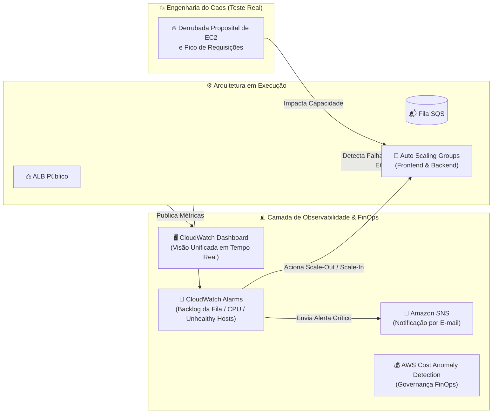

# 📊 Dia 03 — Operação e Resiliência: Observabilidade, FinOps e Engenharia do Caos

[⬅️ Voltar para o Dia 02](../dia-02/README.md) | [🏠 Voltar para a Página Principal](../README.md)

---

## 🎯 Descrição e Objetivo Pedagógico da Etapa

No **Dia 03**, mudamos o foco da construção para a **Operação de Confiabilidade (SRE) e Observabilidade**. Com a arquitetura pronta e elástica, implementamos:
1. **Observabilidade Centralizada:** Construção de um painel unificado (*Dashboard*) no **Amazon CloudWatch** correlacionando métricas de entrada do ALB, profundidade da fila SQS (`ApproximateNumberOfMessagesVisible`), saúde do Auto Scaling e escrita no DynamoDB.
2. **Escalabilidade Orientada a Negócio (Backlog Scaling):** Ajuste fino do Auto Scaling do Backend considerando a fila de trabalho pendente, além de alertas automáticos via **Amazon SNS** e controle financeiro com **AWS Cost Anomaly Detection**.
3. **Engenharia do Caos (*Chaos Testing*):** Provocamos falhas deliberadas em produção (encerramento forçado de instâncias EC2 e injeção de carga) para observar a reação autônoma da arquitetura, validando o tempo de detecção e o *Self-Healing* sem perda de mensagens.

---

## 📐 Fluxo de Observabilidade e Auto-Recuperação — Cenário Dia 03

---

## 🧪 Resultados dos Testes de Caos e Resiliência

| Cenário de Falha Provocado | Comportamento Esperado | Comportamento Observado na Prática | Resultado |
| :--- | :--- | :--- | :---: |
| **1. Desligamento abrupto de 1 instância de Frontend** | O ALB deve parar de enviar tráfego para a máquina morta e o ASG deve criar uma substituta. | O Target Group detectou a falha no *Health Check*, roteou 100% do tráfego para a instância sobrevivente na outra AZ e o ASG provisionou uma nova EC2 automaticamente. | ✅ **Aprovado (Zero Downtime)** |
| **2. Desligamento das instâncias de Backend durante envio de mensagens** | As mensagens enviadas pelo site não podem ser perdidas; devem aguardar na fila até o Backend se recuperar. | O SQS acumulou as mensagens com segurança (aumento visível no gráfico `MessagesVisible` do CloudWatch). Assim que o ASG recriou os Workers, a fila foi esvaziada e gravada no DynamoDB. | ✅ **Aprovado (Zero Data Loss)** |
| **3. Picos de envio simultâneo no Frontend** | A fila absorve a rajada e o alarme do CloudWatch aciona a adição de mais Workers. | Latência do usuário permaneceu em milissegundos no envio; o processamento ocorreu de forma assíncrona e controlada. | ✅ **Aprovado (Alta Resiliência)** |

---

## 🔒 Governança Final do Ambiente
Conforme estabelecido nas regras do projeto, **todos os recursos dos Dias 01, 02 e 03 permanecem provisionados e operacionais** na conta AWS (`us-east-2`), mantendo os painéis do CloudWatch alimentados até a avaliação final do instrutor.