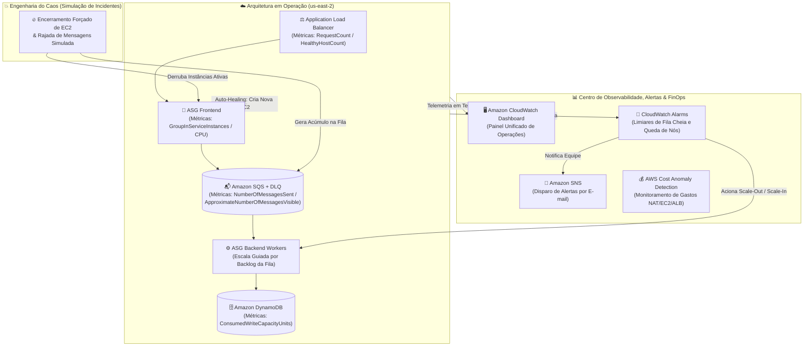

  <h1>📊 Dia 03 — Operação e Resiliência</h1>
  <h3>Observabilidade com CloudWatch, Escala por Backlog, FinOps e Engenharia do Caos</h3>
  

    <a href="../dia-02/README.md">⬅️ Voltar para o Dia 02</a> • 
    <a href="../README.md">🏠 Voltar para a Página Principal</a>
  

---

## 🎯 Descrição Didática do Desafio (O Projeto do Dia 03)

No **Dia 03**, mudamos a mentalidade: em vez de apenas criar recursos novos, passamos a **operar e colocar à prova a arquitetura que já existe**. 

**O que fizemos nesta etapa:**
1. **Visibilidade Total ([Amazon CloudWatch](https://aws.amazon.com/pt/cloudwatch/)):** Criamos um painel de controle (*Dashboard*) reunindo as métricas vitais do Load Balancer, do Auto Scaling e da fila SQS em uma única tela.
2. **Alertas e Escalabilidade Inteligente:** Configuramos tópicos no **[Amazon SNS](https://aws.amazon.com/pt/sns/)** para enviar notificações por e-mail em caso de anomalias, diretrizes de **[AWS Cost Anomaly Detection](https://aws.amazon.com/pt/aws-cost-management/aws-cost-anomaly-detection/)** e ajustamos a política do Auto Scaling do consumidor da fila com base no **volume de mensagens pendentes (Backlog por instância)**.
3. **Engenharia do Caos (*Chaos Testing*):** Provocamos falhas propositais (derrubando instâncias EC2 e injetando picos de mensagens) para observar como a arquitetura reage sozinha, entendendo o tempo de resposta dos *Health Checks* e comprovando o *Self-Healing*.

---

## 📐 Topologia Operacional e Observabilidade — Cenário Dia 03 (Mermaid.js)

---

## 🛠️ Tecnologias AWS Utilizadas e Glossário da Etapa

| Serviço / Conceso AWS | Função Construída no Dia 03 | Definição no Glossário |
| :--- | :--- | :--- |
| **[Amazon CloudWatch Dashboards](https://aws.amazon.com/pt/cloudwatch/)** | Exibe gráficos em tempo real da fila SQS, instâncias ativas e requisições no ALB. | Painéis personalizáveis na nuvem para monitorar recursos em uma única visualização. |
| **[Amazon CloudWatch Alarms](https://aws.amazon.com/pt/cloudwatch/)** | Monitora métricas como `ApproximateNumberOfMessagesVisible` e aciona ações automáticas. | Recurso que observa uma métrica e executa ações (Auto Scaling ou SNS) ao cruzar um limite. |
| **[Amazon SNS](https://aws.amazon.com/pt/sns/)** | Envia alertas automáticos por e-mail para o administrador quando um alarme dispara. | Serviço gerenciado de mensageria pub/sub para notificações e alertas operacionais. |
| **Backlog per Instance Scaling** | Escala os Workers de Backend pelo número de mensagens acumuladas na fila dividido pelo número de máquinas. | Prática recomendada pela AWS para dimensionar consumidores de fila de forma proporcional à demanda real. |
| **[AWS Cost Anomaly Detection](https://aws.amazon.com/pt/aws-cost-management/aws-cost-anomaly-detection/)** | Monitora desvios de custos em recursos tarifados por hora/GB (como NAT Gateway, ALB e EC2). | Ferramenta de FinOps que usa Machine Learning para detectar gastos inesperados na conta AWS. |

---

## 🧪 Evidências Reais dos Testes de Falha e Engenharia do Caos

Durante o laboratório do Dia 03, provocamos falhas intencionais para comprovar a resiliência da arquitetura:

| Experimento de Caos Executado | O que Aconteceu na Infraestrutura | Como a Arquitetura Reagiu Sozinha (Evidência) |
| :--- | :--- | :--- |
| **1. Terminação Proposital de Instância Frontend** | Uma instância EC2 web foi encerrada manualmente pela console durante o envio de requisições. | O Target Group (`grupo-frontend-vagner-tomaz`) identificou a falha no *Health Check*, direcionou 100% dos usuários para a instância saudável na outra AZ (sem erro na tela) e o ASG subiu uma máquina nova automaticamente. |
| **2. Interrupção dos Workers Backend com Envio em Massa** | Paramos os consumidores enquanto novas mensagens eram enviadas pelo formulário web. | As mensagens ficaram retidas com total segurança na `fila-registros-vagner-tomaz` (gráfico de mensagens visíveis subiu no CloudWatch). Assim que o ASG restaurou os Workers, o backlog foi consumido até zerar e gravado no DynamoDB. |
| **3. Diagnóstico de Latência de Recuperação** | Medição do tempo entre a queda de uma máquina e a entrada da substituta em estado *Healthy*. | Observado no painel do CloudWatch o ciclo completo de detecção, lançamento via *Launch Template*, execução do *User Data* (busca no SSM) e validação pelo ALB. |

---

## 🎯 Alinhamento e Cobertura [AWS SAA-C03](https://aws.amazon.com/pt/certification/certified-solutions-architect-associate/) — Dia 03

Distribuição do peso técnico abordado especificamente na operação do **Dia 03** conforme o [Guia do Exame SAA-C03](https://docs.aws.amazon.com/pt_br/aws-certification/latest/solutions-architect-associate-03/solutions-architect-associate-03.html):

| Domínio Oficial SAA-C03 | Cobertura no Dia 03 | Práticas e Melhores Práticas Aplicadas na Etapa |
| :--- | :---: | :--- |
| **Domínio 2: Arquiteturas Resilientes** *(Peso Oficial: 26%)* | **45%** | Testes empíricos de *Chaos Engineering*, comprovação de *Self-Healing* via Auto Scaling e retenção de mensagens sob falha. |
| **Domínio 3: Alto Desempenho** *(Peso Oficial: 24%)* | **20%** | Monitoramento de métricas de vazão no CloudWatch e dimensionamento elástico guiado por *Backlog por Instância*. |
| **Domínio 4: Custo Otimizado** *(Peso Oficial: 20%)* | **20%** | Governança FinOps sobre NAT Gateways/EC2/ALB, *Scale-In* automático após esvaziar a fila e controle de anomalias de custo. |
| **Domínio 1: Arquiteturas Seguras** *(Peso Oficial: 30%)* | **15%** | Operação e diagnóstico realizados sem exposição de rede pública, mantendo o princípio de menor privilégio. |

---

## 🚀 Resumo de Melhores Práticas e Evoluções Futuras do Projeto (Roadmap)

* **Melhores Práticas Consolidadas nos 3 Dias:**
  * Arquitetura 3-Tier Multi-AZ desacoplada com SQS + DLQ;
  * Segurança em profundidade (Sub-redes privadas, SG encadeado, IAM Roles, SSM Parameter Store e Session Manager Zero-SSH);
  * Observabilidade ativa no CloudWatch e recuperação autônoma validada por testes de falha.
* **Próximos Passos para Evolução Futura (Pós-Avaliação):**
  1. **Infraestrutura como Código (IaC):** Codificar toda a topologia validada em módulos **Terraform** ou **AWS CloudFormation**.
  2. **HTTPS e Borda Segura:** Adicionar certificado SSL/TLS no ALB via **AWS Certificate Manager (ACM)** e proteção **AWS WAF** no CloudFront.
  3. **Modernização para Containers:** Evoluir os scripts EC2 para containers gerenciados no **Amazon ECS / AWS Fargate** consumindo a mesma fila SQS.

---

## 🔒 Status do Ambiente AWS
> **Conformidade de Avaliação:** Todos os recursos permanecem ativos e monitorados na região `us-east-2` (sem execução da limpeza de fim de laboratório), aguardando a avaliação e autorização final do **Prof. Ednilson Cipolla**.