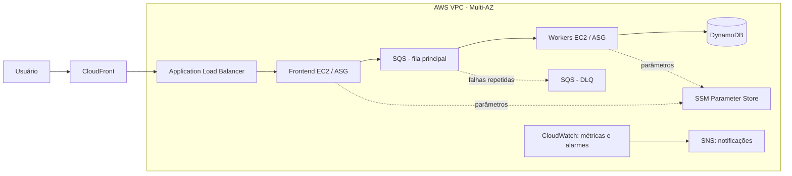

# 02 — Visão geral da arquitetura

## Objetivo
Apresentar a topologia macro. Os detalhes específicos ficam nos documentos de cada laboratório.

## Topologia lógica

> Diagrama macro-alvo consolidado a partir do roteiro da Semana de Arquitetura. A presença de um componente no desenho não comprova sua implementação.

## Fluxo
1. Usuário acessa a aplicação pela camada de distribuição e balanceamento.
2. Frontend recebe a solicitação e publica mensagem no SQS.
3. Workers consomem mensagens de forma assíncrona.
4. Processamento persiste o resultado no DynamoDB.
5. Mensagens que excedem as tentativas configuradas podem ir para DLQ.
6. CloudWatch e SNS apoiam operação e alertas.

## Camadas
| Camada | Componentes | Responsabilidade |
|---|---|---|
| Entrada | CloudFront, ALB | Distribuição e encaminhamento |
| Apresentação | EC2, ASG | Hospedar aplicação web |
| Mensageria | SQS, DLQ | Buffer e isolamento de falhas |
| Processamento | EC2 Workers, ASG | Consumir e processar mensagens |
| Persistência | DynamoDB | Armazenar registros |
| Configuração e acesso | Parameter Store, IAM, Session Manager | Configuração e acesso operacional |
| Observabilidade | CloudWatch, SNS | Métricas, alarmes e notificações |

## Rede e endereçamento
O README anterior registra VPC 10.0.0.0/16, região us-east-2, duas sub-redes públicas e quatro privadas em us-east-2a e us-east-2b. Confirmar esses dados com evidências antes de declará-los como baseline validado.

| AZ | Sub-rede | CIDR real | Tabela de rotas | Finalidade |
|---|---|---|---|---|
| AZ A | Pública | A confirmar | A confirmar | Entrada/saída conforme desenho |
| AZ B | Pública | A confirmar | A confirmar | Entrada/saída conforme desenho |
| AZ A | Privada - apresentação | A confirmar | A confirmar | Frontend |
| AZ B | Privada - apresentação | A confirmar | A confirmar | Frontend |
| AZ A | Privada - processamento | A confirmar | A confirmar | Workers |
| AZ B | Privada - processamento | A confirmar | A confirmar | Workers |

## Verificações de segurança
- Security Group do ALB aceita apenas portas e origens necessárias.
- Instâncias aceitam tráfego somente das origens previstas.
- Instâncias privadas não possuem exposição pública desnecessária.
- IAM Roles seguem privilégio mínimo.
- Session Manager é usado quando configurado.
- Nomes de filas e tabelas são configurações operacionais, não necessariamente segredos.
- CloudFront não bloqueia, sozinho, acesso direto ao DNS do ALB. Validar o mecanismo de restrição da origem se CloudFront for a única entrada desejada.

## Mensageria e idempotência
SQS Standard oferece entrega pelo menos uma vez. O consumidor deve tolerar mensagens duplicadas por meio de processamento idempotente. Registrar visibility timeout, retention, redrive policy, DLQ e comportamento em falhas.
