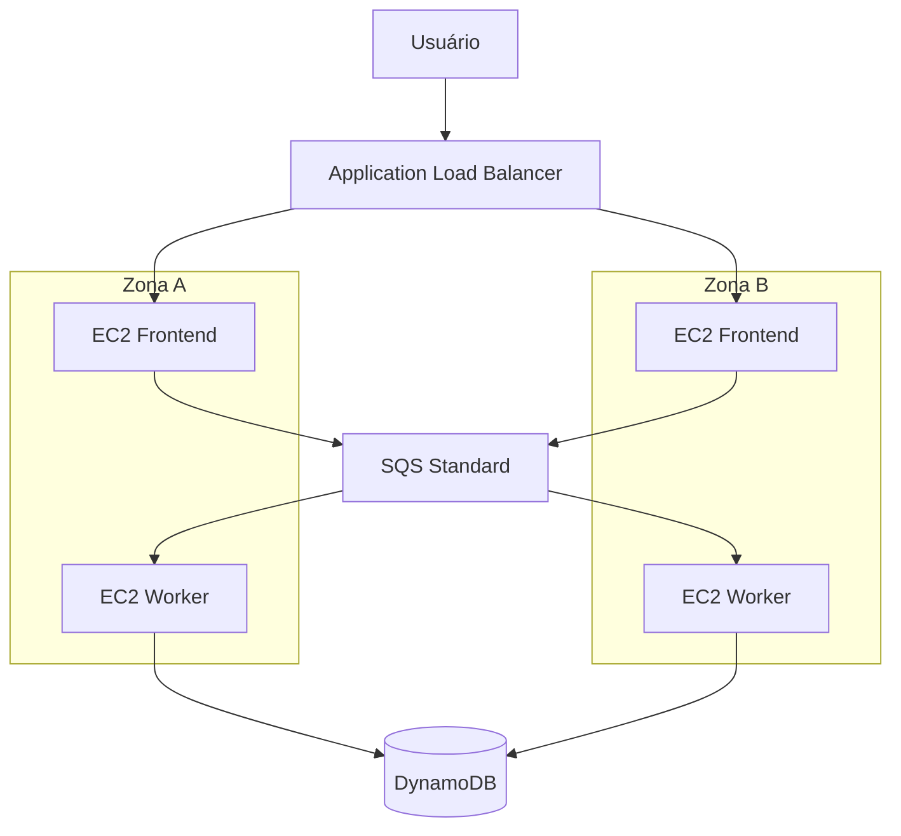

# Dia 1 — Construindo a fundação: três camadas e processamento assíncrono

## Objetivo
Construir a base de uma aplicação web com separação entre frontend, processamento e persistência, usando ALB, EC2, SQS e DynamoDB.

## Topologia lógica

> Diagrama lógico baseado no registro anterior do repositório. Confirmar distribuição efetiva nas evidências.

## Serviços e funções
| Serviço | Função |
|---|---|
| VPC e sub-redes | Isolamento e segmentação de rede |
| Internet Gateway / NAT Gateway | Conectividade conforme rotas |
| Application Load Balancer | Distribuir requisições ao frontend |
| EC2 | Hospedar frontend e workers |
| SQS Standard | Buffer e desacoplamento |
| DynamoDB | Persistir registros |
| IAM Role | Permissões temporárias das instâncias |

## Baseline registrado
README anterior registra região us-east-2, VPC 10.0.0.0/16, duas sub-redes públicas e quatro privadas em duas AZs, ALB, EC2, SQS e DynamoDB. Confirmar nomes e configurações no ambiente/evidências.

## Endereçamento
| Camada | AZ | CIDR | Recurso |
|---|---|---|---|
| Pública | A | A confirmar | ALB / NAT conforme configuração |
| Pública | B | A confirmar | ALB / NAT conforme configuração |
| Frontend privada | A | A confirmar | EC2 frontend |
| Frontend privada | B | A confirmar | EC2 frontend |
| Backend privada | A | A confirmar | EC2 worker |
| Backend privada | B | A confirmar | EC2 worker |

## Checklist de evidências
| Item | Evidência esperada | Status |
|---|---|---|
| DynamoDB | Tabela e chave requestId | A confirmar |
| SQS | Fila e configuração | A confirmar |
| Security Groups | Regras e origens permitidas | A confirmar |
| IAM | Role e políticas | A confirmar |
| Frontend | Instâncias em AZs distintas | A confirmar |
| Target Group | Targets saudáveis | A confirmar |
| ALB | Listener e DNS | A confirmar |
| Teste frontend | Página acessível e requisição enviada | A confirmar |
| Backend | Workers em execução | A confirmar |
| Processamento | Mensagem consumida | A confirmar |
| Persistência | Registro localizado pelo requestId | A confirmar |

## Troubleshooting
O README anterior registra parâmetros operacionais diretamente no código, necessidade de acesso manual às instâncias e ausência de substituição automática. Tratar como diagnóstico registrado, não como evidência reproduzida.

| Sintoma | Verificações | Resultado a documentar |
|---|---|---|
| Frontend indisponível | Listener, Target Group, SG, rota e aplicação | Health check e logs |
| Worker não consome | IAM, URL da fila, conectividade e polling | Política e consumo SQS |
| Não persiste | Permissões DynamoDB, chave e exceções | Logs e consulta pelo requestId |
| Target unhealthy | Porta, health check, processo e SG | Correção e estado saudável |

Não inventar erros ou mensagens que não foram registradas.

## Resumo e melhorias propostas
Preencher o resumo após confirmar o que foi executado. Melhorias candidatas: idempotência do consumidor SQS, visibility timeout e DLQ adequados, privilégio mínimo, health checks documentados e avaliação de endpoints VPC para reduzir dependência de NAT quando apropriado.
