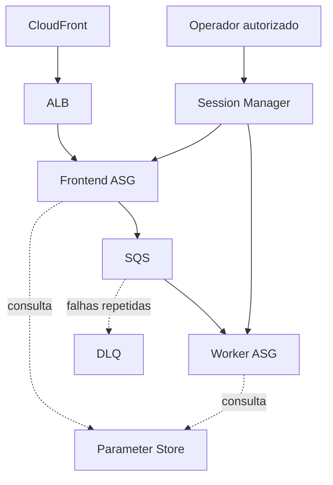

# Dia 2 — Endurecendo a arquitetura: configuração segura e elasticidade

## Objetivo
Reduzir dependência de parâmetros gravados no código e introduzir padronização e escalabilidade horizontal.

## Serviços e funções
| Serviço | Função |
|---|---|
| Systems Manager Parameter Store | Centralizar parâmetros |
| Session Manager | Acesso administrativo sem SSH aberto |
| EC2 Launch Template | Padronizar lançamento |
| EC2 Auto Scaling Group | Ajustar e manter capacidade |
| IAM | Controlar acesso a parâmetros e instâncias |
| CloudFront | Distribuição de conteúdo conforme desenho |
| SQS DLQ | Isolar mensagens não processadas |

## Topologia-alvo

> Diagrama-alvo baseado no roteiro. Confirmar os componentes efetivamente configurados.

## Validações
- Parâmetros existem e são lidos pela aplicação.
- Distinguir configuração operacional de segredo; usar SecureString/KMS quando houver dado confidencial.
- IAM permite leitura apenas dos parâmetros necessários.
- Launch Templates e ASGs padronizam e gerenciam instâncias, se executados.
- Health checks e substituição estão documentados.
- Session Manager funciona com permissões e conectividade exigidas.
- Validar se o ALB pode ser acessado diretamente quando CloudFront deve ser a única entrada.
- DLQ tem redrive policy e teste controlado.

## Resumo e melhorias
Registrar recursos, configurações, testes e resultados reais. Melhorias candidatas: parâmetros por ambiente, IAM restrito por ARN, capacidade mínima/máxima/desired justificada e proteção da origem CloudFront.
