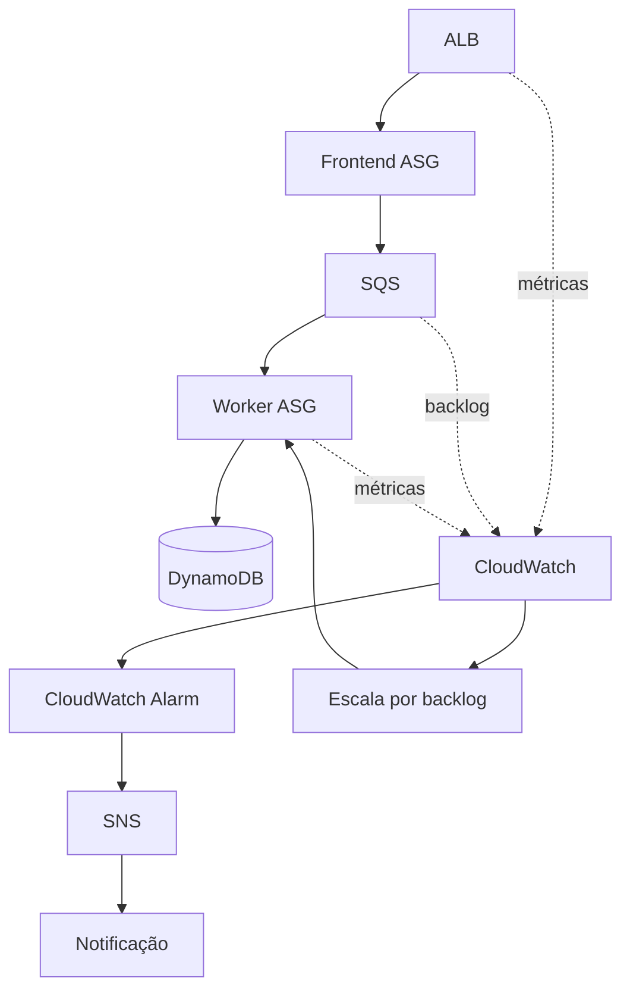

# Dia 3 — Operando a arquitetura: observabilidade e resiliência

## Objetivo
Observar o comportamento, detectar anomalias e validar resposta a aumento de demanda e falhas.

## Serviços e funções
| Serviço | Função |
|---|---|
| CloudWatch | Métricas, dashboards e alarmes |
| SNS | Distribuir notificações |
| SQS | Métricas de profundidade e idade |
| EC2 Auto Scaling | Ajustar capacidade dos workers |
| Cost Anomaly Detection | Identificar padrões incomuns de gasto |

## Topologia-alvo

## Validações
- Dashboard inclui métricas relevantes de ALB, ASG e SQS.
- Alarmes têm limiar, período, avaliação e ação documentados.
- SNS envia notificação de teste.
- Escalabilidade do consumidor considera backlog por instância, se configurada.
- Teste de falha registra condição inicial, ação, comportamento e recuperação.
- Cost Anomaly Detection está habilitado, se executado.
- Custos têm período, região e premissas.

## Plano mínimo de testes
| Teste | Procedimento | Resultado |
|---|---|---|
| Backlog | Produzir mensagens em volume controlado | Profundidade e idade da fila |
| Recuperação | Encerrar instância de teste com autorização | Substituição e tempo observado |
| DLQ | Enviar mensagem de teste com falha controlada | Encaminhamento |
| Alarme | Simular condição acima do limiar | Estado e notificação |
| Persistência | Consultar registros processados | Itens no DynamoDB |

Não executar testes de carga ou encerramento de instâncias sem avaliar custo, impacto e autorização. Não declarar resultados sem evidência.

## Resumo e melhorias
Registrar configuração, procedimento, resultado e limitações. Melhorias candidatas: alarmes para idade da mensagem mais antiga, runbooks, retenção de logs e repetição de testes controlados.
